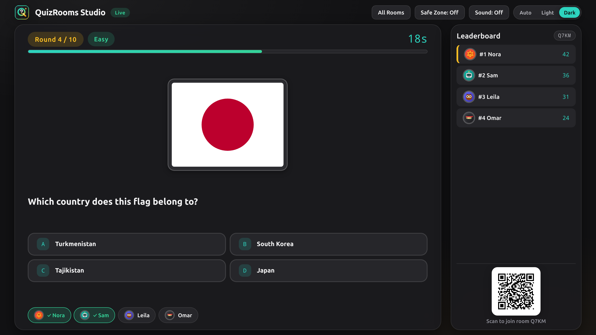
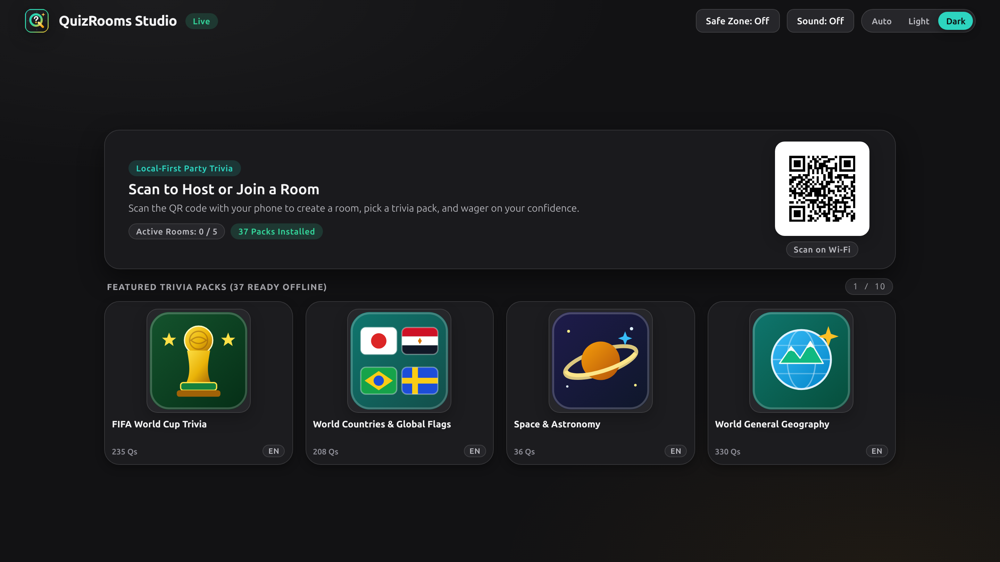
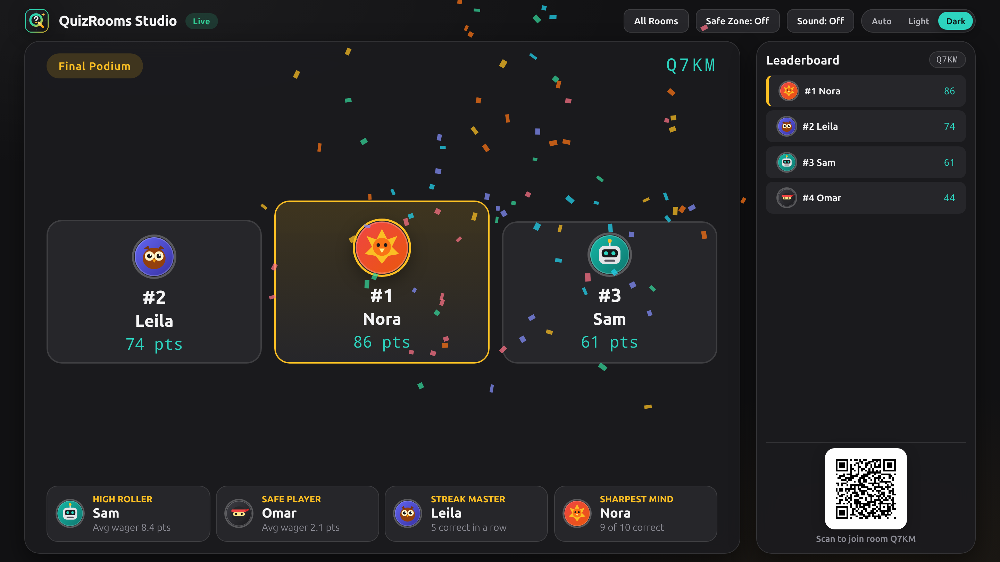
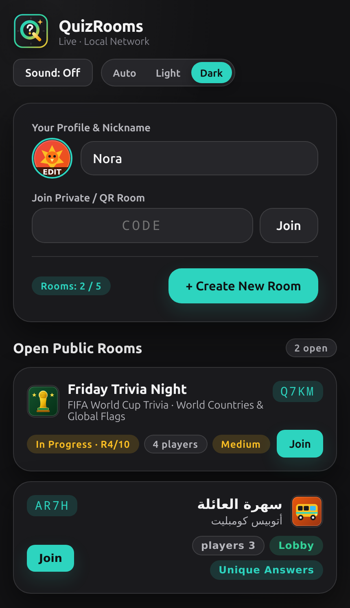
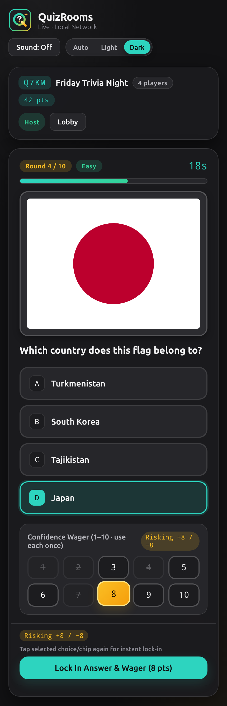
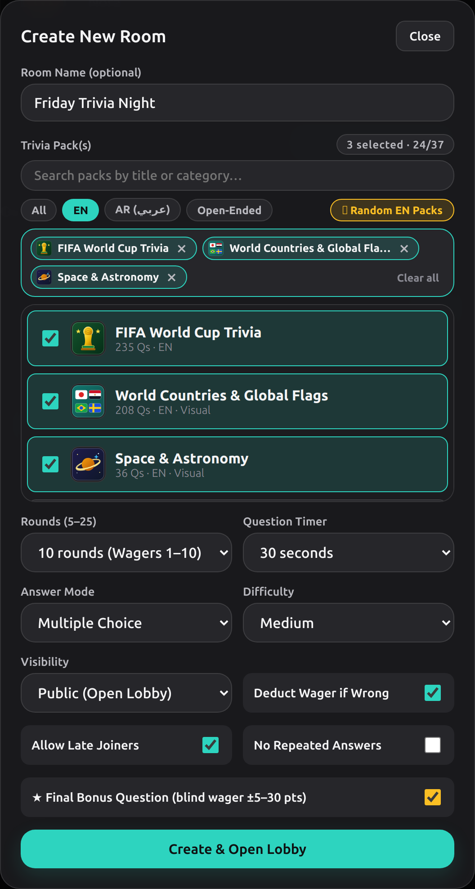
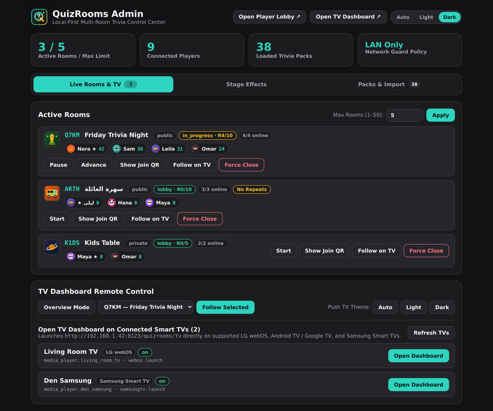
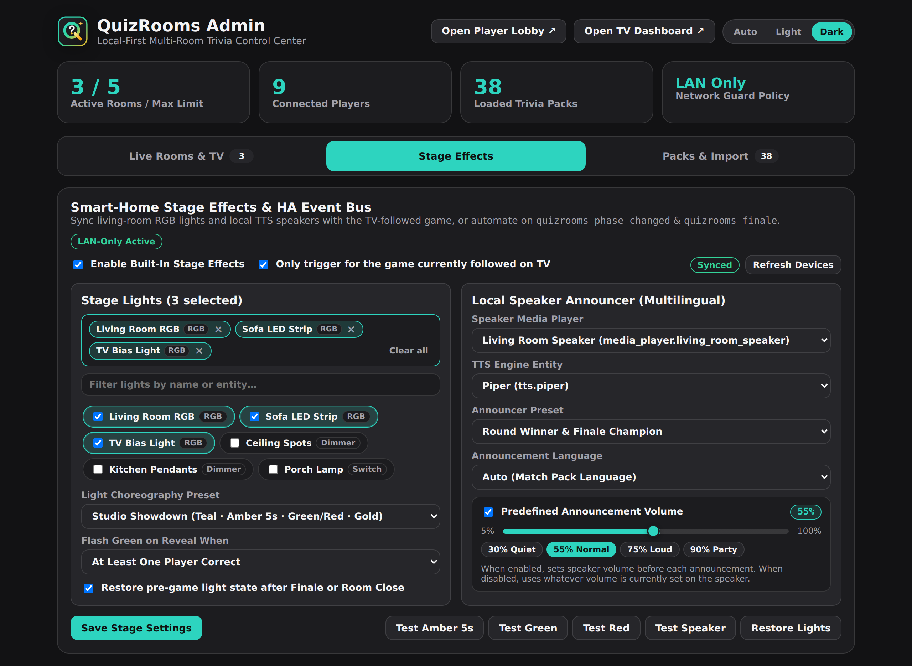
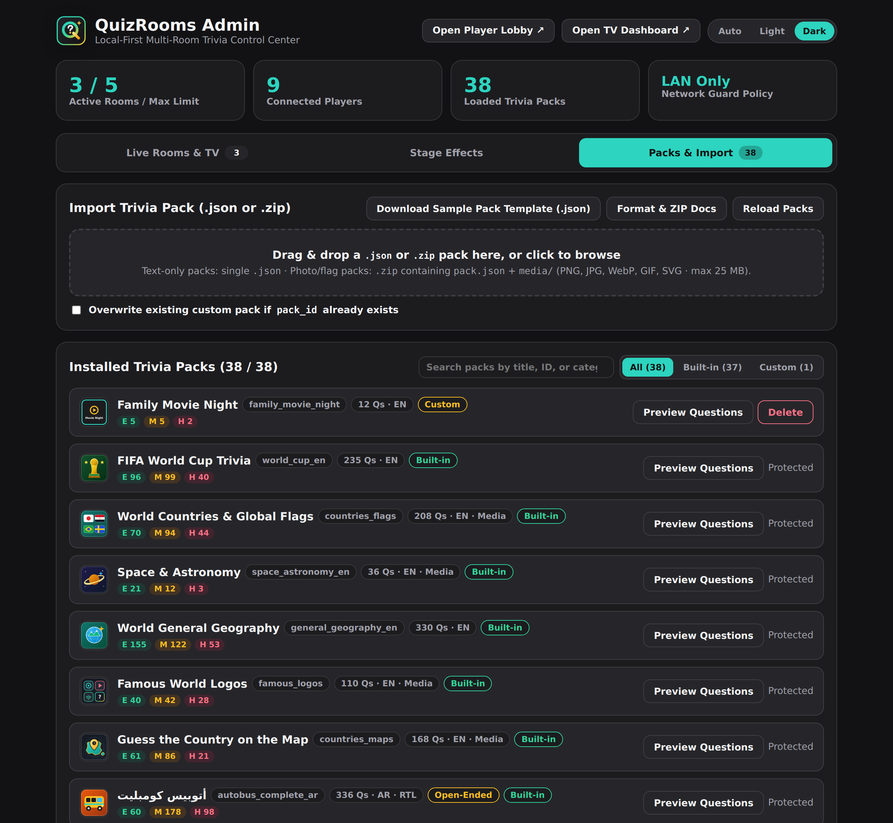

<p align="center">
  
</p>

<h1 align="center">QuizRooms for Home Assistant</h1>

<p align="center">
  <strong>Local-first, multi-room confidence-wagering party trivia for Home Assistant</strong><br/>
  Zero external CDNs · Zero Python dependencies · 37 built-in packs (3,064 questions) · Full English &amp; Arabic/RTL · 16:9 Smart TV Studio · TV-Synced Smart-Home Stage Effects
</p>

---

## ⭐ Support & Star the Project

If **QuizRooms** brings fun to your family game nights, living room TV, or Home Assistant setup, please consider **giving this repository a ⭐ Star on GitHub**!

- ⭐ **Star [modestpharaoh/hass-quiz-rooms](https://github.com/modestpharaoh/hass-quiz-rooms)** — it helps other Home Assistant enthusiasts discover the project and motivates continued development and new trivia packs.
- 💡 **Share ideas & custom packs** — open an [Issue](https://github.com/modestpharaoh/hass-quiz-rooms/issues) to suggest trivia pack themes, Smart TV improvements, or language additions.
- 🐛 **Report bugs** — include your Home Assistant version, device/TV browser, and steps to reproduce.

---

## Screenshots

The same local UI your household actually uses: a phone in hand, a 16:9 TV on the wall, and the Home Assistant sidebar.

<p align="center">
  
</p>
<p align="center"><sub><strong>TV Studio</strong> — follow the live round, leaderboard, and join QR on the living-room display</sub></p>

<table>
  <tr>
    <td width="50%" align="center" valign="top">
      
      <br /><sub><strong>Idle screen</strong> — scan to host, with featured packs ready offline</sub>
    </td>
    <td width="50%" align="center" valign="top">
      
      <br /><sub><strong>Finale</strong> — podium, awards, and the room QR still on screen</sub>
    </td>
  </tr>
</table>

<p align="center"><strong>Play</strong> — open lobby, confidence wager, and room setup on a phone</p>

<table>
  <tr>
    <td width="33%" align="center" valign="top">
      
      <br /><sub><strong>Open lobby</strong> — profile, public rooms, English and Arabic</sub>
    </td>
    <td width="33%" align="center" valign="top">
      
      <br /><sub><strong>Lock in</strong> — pick an answer and wager the points you still have</sub>
    </td>
    <td width="33%" align="center" valign="top">
      
      <br /><sub><strong>Create a room</strong> — search packs, set the rules, add a bonus round</sub>
    </td>
  </tr>
</table>

<p align="center"><strong>Admin</strong> — Home Assistant sidebar panel</p>

<p align="center">
  
</p>
<p align="center"><sub><strong>Live Rooms &amp; TV</strong> — rooms, join QR, follow mode, and one-click launch on LG webOS and Samsung TVs</sub></p>

<table>
  <tr>
    <td width="50%" align="center" valign="top">
      
      <br /><sub><strong>Stage Effects</strong> — living-room lights and a local TTS announcer, LAN only</sub>
    </td>
    <td width="50%" align="center" valign="top">
      
      <br /><sub><strong>Packs &amp; Import</strong> — built-in library plus drag-and-drop custom packs</sub>
    </td>
  </tr>
</table>

---

## Key Features

- **100% Local-First & Zero External Dependencies:** All HTML, CSS, JavaScript, QR code generation, Web Audio SFX, 208 vector flags, 169 country map silhouettes, 110 brand logos, 37 square pack covers, 20 studio SVG avatars, original science/anatomy/wildlife/landmark diagrams, and local Latin + Arabic + Monospace WOFF fonts are served directly by Home Assistant (`"requirements": []`).
- **Strict LAN-Only Security & DoS Hardening (`NetworkGuard`):** Guest, TV, WebSocket, and media routes (`/quizrooms/play`, `/quizrooms/tv`, `/quizrooms/ws`, `/quizrooms/media/...`, `/quizrooms/avatar/...`) allow only RFC 1918 + IPv6 ULA/link-local + admin-configured CIDRs by default, with fail-closed reverse-proxy & tunnel protection (`X-Forwarded-For`, Cloudflare `CF-Connecting-IP`/`CF-Ray`, Nabu Casa `X-Hass-Source`), CSWSH `Origin` checks (blocking `Origin: null`), global/per-IP WebSocket caps + slow-consumer eviction, bounded JSON/multipart stream guards, validated/sandboxed SVG delivery (`CSP: default-src 'none'; sandbox`), and automatic memory pruning.
- **Multi-Room Confidence Wagering & Blind Final Bonus Round:**
  - Concurrent Public and Private rooms, rounds in multiples of `5` (`5–25`), configurable question timers (`20s / 30s / 45s / 60s`), difficulty filtering (`Random`, `Easy`, `Medium`, `Hard`), snapshot isolation, and automatic idle TTL cleanup (15 min lobbies / 2 hr games).
  - One-time confidence wager chips (`1..N`, defaulting to lowest remaining chip) with optional wrong-wager deduction toggle.
  - Optional **★ Final Bonus Question (`bonus_round`)**: a blind high-stakes wager phase (`±5`–`±15` pts for 5 rounds; `±5`–`±30` pts for 10–25 rounds) where players lock their wager *before* seeing the final question (`+Wager` if correct, `−Wager` if wrong).
- **Open-Ended Party Games & No Repeated Answers:** Supports `open_ended: true` packs (**أتوبيس كومبليت** & **Autobus Complete**) with automatic starting-letter checking (`starts_with`) and a host toggle to reject duplicate answers across players in the same round or reused from earlier rounds (including Arabic spelling/diacritic/article normalization).
- **Mobile Guest SPA (`/quizrooms/play`):**
  - Sticky bottom Lock-In bar for one-handed phone play (`env(safe-area-inset-bottom)`), optional haptic vibration (`navigator.vibrate`) paired with Web Audio SFX, smart wager risk hints (`Risking +7 / −7` or `+7 / 0`), tiered wager grouping for `N >= 15`, tap-again fast confirm, non-destructive Reconnecting banner preserving typed drafts, and confirmation-protected room closing.
  - Fast **Create Room** pack picker with search, language/mode filters (`All`, `EN`, `AR`, `Open-Ended`), per-language **🎲 Random Packs** picker, and a live Selected Packs chip strip.
- **Globally Unique Player Avatars:** Choose from 20 studio SVG characters reserved uniquely across all active rooms or upload a client-cropped custom profile photo.
- **16:9 TV Studio Dashboard (`/quizrooms/tv`) & Smart TV Launcher:**
  - Viewport-fit (`100vh`) layout tuned for 720p-CSS Smart TV browsers (LG webOS, Samsung Tizen), Full HD (1080p), and 4K displays, with Overview & Follow modes and one-click launch from the Admin Panel to connected LG webOS, Android TV / Google TV, and Samsung Smart TVs.
  - Native TV remote D-Pad `:focus-visible` rings & arrow-key / Back-button navigation, **Safe Zone (Overscan)** bezel-padding toggle, animated `+N`/`−N` score deltas & `▲`/`▼` rank arrows on Reveal, final-5s amber→coral urgency pulse + **"All Locked In!"** transition banner, and a rotating 1:1 square-cover **Featured Trivia Packs** showcase on the idle screen.
- **Home Assistant Event Bus & TV-Synced Smart-Home Stage Effects (LAN-Only):**
  - Emits native `quizrooms_phase_changed` (including a `T-5s` final countdown hook) and `quizrooms_finale` events for custom automations.
  - Built-in zero-YAML **Stage Director** in the Admin Panel syncs living-room RGB/dimmer lights (Teal → Amber 5s pulse → Green/Red reveal flash → Trophy Gold + automatic pre-game light restore) and a local multilingual TTS speaker announcer (**Auto**, **EN**, **AR**, **DE**, **FR**, **ES**, **PT** + optional predefined volume) with the game followed on TV — automatically locked and discarded whenever External Access is enabled.
- **Tabbed Admin Sidebar Panel & Hot Pack Importer:** Pinned KPI strip + 3 clean tabs (**Live Rooms & TV**, **Stage Effects**, **Packs & Import**), inline **Show Join QR** popovers on active rooms, Stage Effects dirty-state guard + Discard/Reset + Selected Lights chip summary, drag-and-drop `.json`/`.zip` pack importer (Zip Slip & Zip Bomb protected), and Installed Packs search, filter (`All / Built-in / Custom`), and expandable **Preview Questions** drawer.
- **Light / Dark / Auto Themes:** Zero-flash theme switcher with neutral charcoal dark-grey studio dark mode and white-framed scannable QR codes.

---

## Installation (HACS)

1. Open **HACS → Integrations → Menu (`⋮`) → Custom repositories**.
2. Add `https://github.com/modestpharaoh/hass-quiz-rooms` with category **Integration**.
3. Install **QuizRooms** and restart Home Assistant.
4. Go to **Settings → Devices & Services → Add Integration → QuizRooms**.
5. Optional: Click **Configure** on the QuizRooms integration card anytime to update network options dynamically (no restart required).

---

## Quick Start (Play in 60 Seconds)

1. **Open the TV Studio Dashboard:** From **Sidebar → QuizRooms → Live Rooms & TV**, click **Open Dashboard** on your connected Smart TV (or open `http://<YOUR_HA_IP>:8123/quizrooms/tv` on any TV or tablet browser).
2. **Scan to Host on Your Phone:** Scan the Join QR code on the TV (or open `http://<YOUR_HA_IP>:8123/quizrooms/play`), pick a nickname & avatar, and tap **Create Room**.
3. **Pick Packs & Rules:** Search or filter by language (`EN`, `AR`, `Open-Ended`), tap **🎲 Random EN/AR Packs** or hand-pick packs, choose rounds (`5–25`), timer (`20–60s`), difficulty, and optional **★ Final Bonus Question**, then tap **Create & Open Lobby**.
4. **Join & Play:** Everyone scans the room QR code on the TV, the TV switches to **Follow** mode (via remote click, Admin Panel, or service call), and the host taps **Start Game**!

---

## Configuration Options

Available during initial setup and anytime under **Settings → Devices & Services → QuizRooms → Configure** (applied live without restarting Home Assistant):

| Option Key | UI Label | Default | Description |
| --- | --- | --- | --- |
| `allow_external_access` | Allow External Access | `false` | When `false` (recommended), guest, TV, WebSocket, and unauthenticated media endpoints are restricted strictly to local/allowed networks. Set `true` only if you intentionally want remote players over WAN/reverse proxy (automatically disables Stage Effects & HA Events for home safety). |
| `allowed_subnets` | Additional Allowed CIDRs | `""` | Optional comma-separated IPv4/IPv6 CIDR subnets (e.g., `100.64.0.0/10, 192.168.50.0/24`) allowed in addition to built-in RFC 1918, IPv6 ULA, and link-local ranges (handy for Tailscale/WireGuard VPNs or VLANs). |
| `custom_lan_base_url` | Custom LAN Base URL | `""` | Optional override URL (e.g., `http://192.168.1.50:8123`) used for QR codes and Smart TV dashboard launching when Home Assistant's detected internal URL differs from your preferred LAN address. |

---

## Device & Entities

All entities are grouped under a single Home Assistant **Service Device** (`QuizRooms`):

| Entity ID | Platform | State / Range | Persistence & Attributes |
| --- | --- | --- | --- |
| `number.quizrooms_max_rooms` | `number` | `1` – `50` (default `5`) | Persisted across restarts via `RestoreEntity`. Lowering the limit while games are running blocks new room creation without terminating active games. |
| `sensor.quizrooms_active_games` | `sensor` | Integer count (`>= 0`) | `state_class: measurement`. Attributes: `max_rooms`, `room_codes`, `rooms` (live room summaries including code, visibility, status, phase, players, and difficulty). |
| `sensor.quizrooms_active_players` | `sensor` | Integer count (`>= 0`) | `state_class: measurement`. Counts currently connected players across all rooms. Attributes: `by_room` (`{room_code: connected_count}`). |

---

## Home Assistant Services

All services are registered under the `quizrooms` domain and can be called from Automations, Scripts, Dashboards, or Developer Tools:

### `quizrooms.tv_set_mode`
Switch connected TV Studio Dashboards between Overview mode and Follow Game mode, and optionally push a theme override.

| Field | Required | Values / Example | Description |
| --- | --- | --- | --- |
| `mode` | Yes | `overview` \| `follow` | Target TV display mode. |
| `room_code` | When `follow` | `"Q7KM"` | 4-character room code to follow. |
| `theme` | No | `auto` \| `light` \| `dark` | Optional theme override pushed to connected TVs. |

```yaml
action: quizrooms.tv_set_mode
data:
  mode: follow
  room_code: "Q7KM"
  theme: dark
```

### `quizrooms.open_tv_dashboard`
Open the QuizRooms TV Studio Dashboard web page (`/quizrooms/tv`) on a connected supported Smart TV `media_player` (**LG webOS** `webostv`, **Android TV** `androidtv` / `androidtv_remote`, or **Samsung Smart TV** `samsungtv` / `samsungtv_smart` / `samsungtv_tizen`).

| Field | Required | Example | Description |
| --- | --- | --- | --- |
| `entity_id` | Yes | `"media_player.living_room_tv"` | Connected supported Smart TV `media_player` entity ID. |
| `url` | No | `"http://192.168.1.50:8123/quizrooms/tv"` | Optional URL override (defaults to the local LAN QuizRooms TV URL). |

```yaml
action: quizrooms.open_tv_dashboard
data:
  entity_id: media_player.living_room_tv
```

### `quizrooms.pause_room`
Pause or resume the active question countdown timer in a running room.

| Field | Required | Example | Description |
| --- | --- | --- | --- |
| `room_code` | Yes | `"Q7KM"` | 4-character room code. |
| `paused` | No | `true` \| `false` | Omit to toggle the room's current pause state. |

```yaml
action: quizrooms.pause_room
data:
  room_code: "Q7KM"
  paused: true
```

### `quizrooms.close_room`
Force-close an active game room and disconnect its participants.

| Field | Required | Example | Description |
| --- | --- | --- | --- |
| `room_code` | Yes | `"Q7KM"` | 4-character room code to close. |

```yaml
action: quizrooms.close_room
data:
  room_code: "Q7KM"
```

### `quizrooms.reload_packs`
Reload built-in and custom trivia packs from disk without disrupting running games (active rooms retain their question & media snapshots).

```yaml
action: quizrooms.reload_packs
```

---

## Home Assistant Event Bus & Smart-Home Stage Effects (LAN-Only)

> **Security Note:** Native Home Assistant events (`quizrooms_phase_changed`, `quizrooms_finale`) and built-in Smart-Home Stage Effects are **strictly available in LAN-Only mode (`allow_external_access: false`)**. If External Access is enabled, all events and physical light/speaker triggers are automatically discarded so remote internet visitors cannot trigger lights or speaker announcements inside your home.

### Built-In Stage Director (Zero-YAML Admin Panel Setup)
Open **Sidebar → QuizRooms → Stage Effects** to pair your living-room devices with the game currently followed on your TV Dashboard:
- **Stage Lights (`light.*`):** Multi-select RGB bulbs/strips or dimmers (with instant search filter and a dedicated **Selected Lights** removable chip bar), pick a preset (**Studio Showdown**, **Subtle Cue**, or **Dramatic Pulse**), and enable **Restore pre-game light state** so lights pulse **Amber** in the final 5 seconds, flash **Emerald Green** / **Crimson Red** on reveal, shimmer **Gold** at Finale, and automatically return to their original pre-game brightness & color.
- **Local Multilingual Speaker Announcer (`media_player.*` + `tts.*`):** Announces round winners and the grand champion with configurable **Announcement Language** (**Auto** matching the pack language, or force **English**, **Arabic**, **German**, **French**, **Spanish**, or **Portuguese**) and optional **Predefined Announcement Volume** (`5%–100%` slider + quick presets, or disabled to follow your speaker's existing volume), plus nickname SSML sanitization and automatic `tts.speak` (with Piper voice/locale switching) / legacy `tts.*_say` detection.

### Native Home Assistant Events
| Event Type | Triggered When | Key Payload Fields |
| --- | --- | --- |
| `quizrooms_phase_changed` | Round starts (`round_start`), 5 seconds left (`final_countdown`), answer revealed (`round_reveal`), paused/resumed (`paused` / `resumed`), or rematch (`play_again`) | `room_code`, `room_name`, `is_tv_followed`, `phase`, `sub_event`, `round_number`, `total_rounds`, `language`, `timer` (`duration_seconds`, `remaining_seconds`), `round_result` (`any_correct`, `majority_correct`, `none_correct`, `round_winner`, `overall_leader`) |
| `quizrooms_finale` | Game reaches Grand Finale podium | `room_code`, `room_name`, `is_tv_followed`, `language`, `is_tie`, `winner`, `co_winners`, `podium` (top 3), `awards` |

### Example YAML Automation
```yaml
automation:
  - alias: "QuizRooms — Living Room TV Stage Lights & Announcer"
    mode: restart
    trigger:
      - platform: event
        event_type: quizrooms_phase_changed
        event_data:
          is_tv_followed: true
        id: phase
      - platform: event
        event_type: quizrooms_finale
        event_data:
          is_tv_followed: true
        id: finale
    action:
      - choose:
          - conditions:
              - condition: trigger
                id: phase
              - condition: template
                value_template: "{{ trigger.event.data.sub_event == 'final_countdown' }}"
            sequence:
              - action: light.turn_on
                target:
                  entity_id: light.living_room_rgb
                data:
                  rgb_color: [245, 158, 11]
                  brightness_pct: 95
                  flash: short
          - conditions:
              - condition: trigger
                id: phase
              - condition: template
                value_template: "{{ trigger.event.data.sub_event == 'round_reveal' }}"
            sequence:
              - action: light.turn_on
                target:
                  entity_id: light.living_room_rgb
                data:
                  rgb_color: "{{ [16, 185, 129] if trigger.event.data.round_result.any_correct else [239, 68, 68] }}"
                  brightness_pct: 100
          - conditions:
              - condition: trigger
                id: finale
              - condition: template
                value_template: "{{ trigger.event.data.winner is not none }}"
            sequence:
              - action: tts.speak
                target:
                  entity_id: tts.piper
                data:
                  media_player_entity_id: media_player.living_room_speaker
                  message: "Congratulations to {{ trigger.event.data.winner.name }} for winning with {{ trigger.event.data.winner.score }} points!"
```

---

## Endpoints

| Endpoint | Access Policy | Purpose |
| --- | --- | --- |
| `/quizrooms/play` | LAN-only (no HA login) | Guest Open Lobby & Mobile Player App |
| `/quizrooms/tv` | LAN-only (no HA login) | 16:9 Studio TV Dashboard (Overview & Follow modes) |
| `/quizrooms/ws` | LAN-only | Multiplexed WebSocket (`?role=lobby\|room\|tv`) |
| `/quizrooms/media/{opaque_id}` | LAN or Authenticated HA User | Sandboxed pack images & covers (`CSP: default-src 'none'; sandbox`) |
| `/quizrooms/avatar/{kind}/{id}` | LAN or Authenticated HA User | Sandboxed preset SVG avatars & uploaded player photos |
| Sidebar → **QuizRooms** | HA Admin required | Tabbed Admin Monitor, Smart TV Launcher, Stage Director & Pack Importer |

---

## Built-In Trivia Packs (37 Packs · 3,064 Questions)

Every built-in pack includes a custom `160×160` square SVG cover and per-question `easy` / `medium` / `hard` difficulty tags (`24` English + `13` Arabic/RTL packs):

| Pack | Language | Mode | Highlights |
| --- | --- | --- | --- |
| **World General Geography** | EN | MC & Free-Text | 330 original questions on rivers, mountains, deserts, oceans, straits, islands, borders & landmarks |
| **FIFA World Cup Trivia** | EN | MC & Free-Text | 235 original questions on champions, finals (1930–2022), hosts, stadiums, Golden Boot winners, records & 2026 |
| **Space & Astronomy / الفضاء والفلك** | EN & AR (RTL) | MC & Free-Text | 36 EN + 36 AR questions on planets, moons, constellations, telescopes & missions with local SVG diagrams |
| **World Cuisines & Signature Dishes / مطابخ وأطباق العالم** | EN & AR (RTL) | MC & Free-Text | 36 EN + 36 AR questions on iconic dishes, spices, street foods & culinary origins |
| **Human Body & Medicine / جسم الإنسان والطب** | EN & AR (RTL) | MC & Free-Text | 36 EN + 36 AR questions on organs, bones, blood types & medical breakthroughs with vector anatomy SVGs |
| **Wildlife & Animal Kingdom / عالم الحيوان والطبيعة** | EN & AR (RTL) | MC & Free-Text | 36 EN + 36 AR questions on habitats, animal records & collective nouns with local wildlife silhouettes |
| **Inventions & Great Discoveries / الاختراعات والاكتشافات** | EN & AR (RTL) | MC & Free-Text | 36 EN + 36 AR questions on historic inventors, everyday technologies & accidental breakthroughs |
| **World Currencies & Timezones** | EN | MC & Free-Text | 40 original questions on world currencies, symbols & extreme global timezone facts |
| **Iconic World Landmarks & Wonders / معالم وعجائب العالم** | EN & AR (RTL) | MC & Free-Text | 36 EN + 36 AR questions on ancient wonders, UNESCO sites, bridges & mosques with vector silhouettes |
| **Sports & Olympic Records / الرياضة والأولمبياد** | EN & AR (RTL) | MC & Free-Text | 36 EN + 36 AR questions on Olympic history, football, tennis, rules & athletic records |
| **Mental Math, Logic & Riddles / ألغاز ومنطق ورياضيات ذهنية** | EN & AR (RTL) | MC & Free-Text | 36 EN + 36 AR fast-paced sequences, geometry puzzles & classic lateral-thinking riddles |
| **أمثال وبلاغة عربية (Arabic Proverbs & Eloquence)** | AR (RTL) | MC & Free-Text | 36 Arabic questions on completing classic proverbs, classical vocabulary, roots & rhetoric |
| **World Countries & Global Flags** | EN | MC & Free-Text | 208 questions featuring locally bundled vector flags (197 countries + EU, UN, Arab League, NATO, Olympics, AU, ASEAN, GCC & more) |
| **Guess the Country on the Map** | EN | MC & Free-Text | 168 questions featuring locally bundled country map silhouette SVGs (derived from Public Domain Natural Earth 1:50m vectors) |
| **Famous World Logos** | EN | MC & Free-Text | 110 locally bundled vector brand/app/gaming/auto/smart-home logo SVGs (via CC0 Simple Icons) |
| **World Countries & Capitals** | EN | MC & Free-Text | 196 world countries & capitals with Arabic/local aliases |
| **World Populations (2026)** | EN | MC & Free-Text | 90 countries with 2026 demographic estimates |
| **Official Languages of the World** | EN | MC & Free-Text | 105 countries & their official national languages |
| **أتوبيس كومبليت** | AR (RTL) | Open-Ended Only | 336 random Arabic rounds (14 categories × 24 letters) |
| **Autobus Complete (English)** | EN | Open-Ended Only | 336 random English rounds (14 categories × 24 letters) |
| **General Knowledge Studio** | EN | MC & Free-Text | 28 curated questions including custom visual SVGs |
| **معلومات عامة عربية** | AR (RTL) | MC & Free-Text | 18 general knowledge questions in Arabic |
| **General Technology** | EN | MC & Free-Text | 36 questions on computing, networking, security & smart homes |
| **التكنولوجيا والمعلوماتية** | AR (RTL) | MC & Free-Text | 36 Arabic technology & computing questions |
| **معلومات عامة عن العالم العربي** | AR (RTL) | MC & Free-Text | 36 Arabic questions on Arab world geography, landmarks & heritage |
| **Europe & Western World GK** | EN | MC & Free-Text | 36 questions on European & Western geography, history & culture |
| **Africa General Knowledge** | EN | MC & Free-Text | 36 questions on African geography, wildlife, kingdoms & heritage |
| **Asia General Knowledge** | EN | MC & Free-Text | 36 questions on Asian peaks, rivers, Silk Road cities & culture |
| **South America General Knowledge** | EN | MC & Free-Text | 36 questions on the Andes, Amazon, Patagonia & landmarks |

---

## Troubleshooting & Tips

- **QR Codes point to the wrong IP or external domain:** Set **Custom LAN Base URL** (e.g., `http://192.168.1.50:8123`) under **Settings → Devices & Services → QuizRooms → Configure**.
- **TV edges slightly clipped on an older TV:** Click **Safe Zone: Off → On** in the top-right header of `/quizrooms/tv` (accessible via TV remote D-Pad) to enable overscan-safe bezel margins.
- **Guests on a guest VLAN / Tailscale get `403 local_network_only`:** Add their subnet CIDR (e.g., `192.168.50.0/24` or `100.64.0.0/10`) to **Additional Allowed CIDRs** in Configure.
- **Stage Effects show "Disabled while External Access is enabled":** By design, smart-home light/speaker effects and HA events run strictly in LAN-Only mode (`allow_external_access: false`).

---

## Documentation

- **[Changelog](CHANGELOG.md)** — Release history and HACS-compatible release notes.
- **[Architecture & Design](docs/ARCHITECTURE.md)** — Backend architecture, state machines (including Blind Final Bonus Round), WebSocket flows, security model, non-blocking async design, Stage Director, and Smart TV launcher diagrams.
- **[Frontend UI & Design System](docs/FRONTEND_DESIGN.md)** — Mobile Player SPA, 16:9 Studio TV Dashboard (Full HD / webOS / Tizen / 4K), Tabbed Admin Sidebar Panel, theming, and RTL layout architecture.
- **[Custom Pack Authoring Guide](docs/PACK_AUTHORING.md)** — Complete `pack.json` schema, `.zip` media packaging, `open_ended` & `difficulty` examples, and security limits.
- **[Third-Party Open-Source Licenses](docs/THIRD_PARTY_LICENSES.md)** — Attribution and full license notices for bundled open-source flags, maps, logos, and local WOFF fonts.

---

## Running Tests

```bash
pytest -v
```

---

## License

**QuizRooms** source code, original trivia packs, studio SVG avatars, pack covers, and brand artwork are licensed under the **[GNU Affero General Public License v3.0 (AGPL-3.0)](LICENSE)**.

Bundled third-party open-source assets (flag SVGs, country map silhouettes, brand logo glyphs, and local WOFF fonts) remain under their own respective licenses (`MIT`, `CC0 1.0`, `Ubuntu Font Licence 1.0`, `DejaVu / Bitstream Vera`, and `SIL OFL 1.1`) as separate aggregate assets and are not relicensed under AGPL-3.0. See [docs/THIRD_PARTY_LICENSES.md](docs/THIRD_PARTY_LICENSES.md) for full notices and license texts.

---

## Credits & Acknowledgments

- **Created & Maintained by:** [@modestpharaoh](https://github.com/modestpharaoh)
- **Built for:** The [Home Assistant](https://www.home-assistant.io/) & [HACS](https://hacs.xyz/) open-source smart-home community.
- **Bundled Open-Source Assets (100% Local & Offline):**
  - **[flag-icons](https://github.com/lipis/flag-icons)** (MIT License) — world country flag SVGs.
  - **[Natural Earth](https://www.naturalearthdata.com/)** (Public Domain / CC0) — 1:50m country boundary vectors used to generate map silhouette SVGs.
  - **[Simple Icons](https://simpleicons.org/)** (CC0 1.0 Universal) — brand vector glyphs used in the Famous World Logos trivia pack.
  - **[Ubuntu Font Family](https://ubuntu.com/legal/font-licence)** (UFL 1.0), **[DejaVu Fonts / Bitstream Vera](https://dejavu-fonts.github.io/)** (DejaVu License), and **[Google Noto Sans Mono](https://fonts.google.com/noto)** (SIL OFL 1.1) — local offline Latin, Arabic, and tabular monospace typography.
  - See [docs/THIRD_PARTY_LICENSES.md](docs/THIRD_PARTY_LICENSES.md) for full license texts and notices.

If you enjoy **QuizRooms**, don't forget to **⭐ star the repo** on GitHub!
