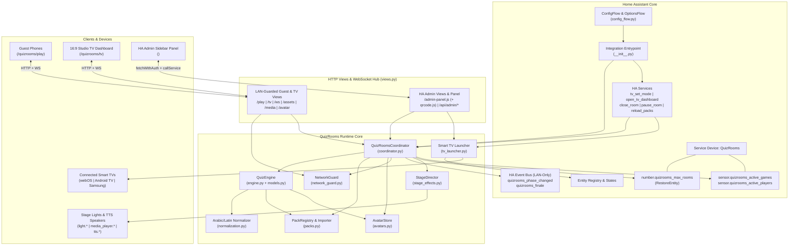
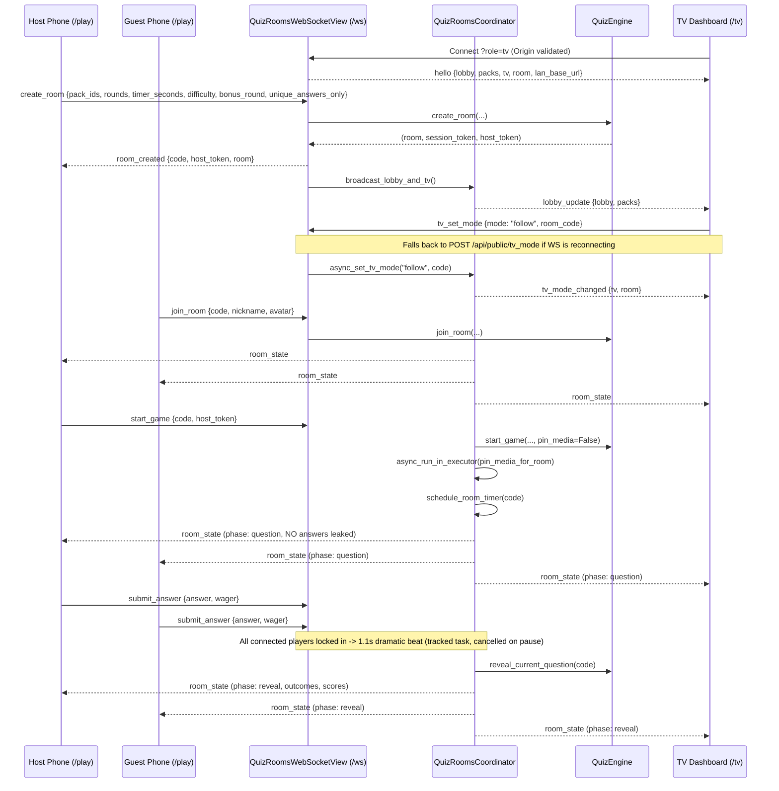
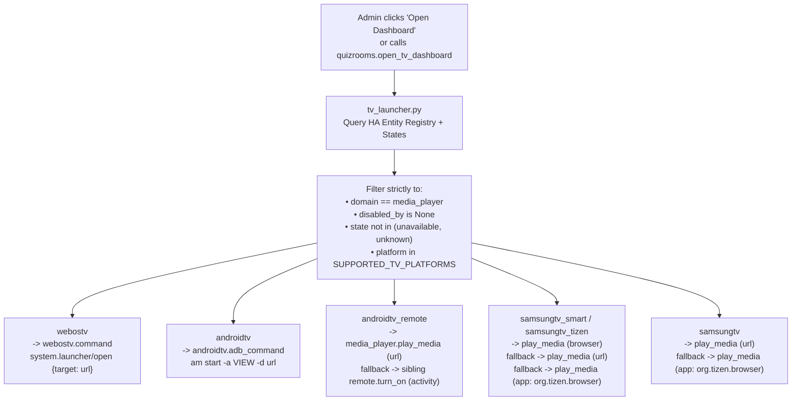
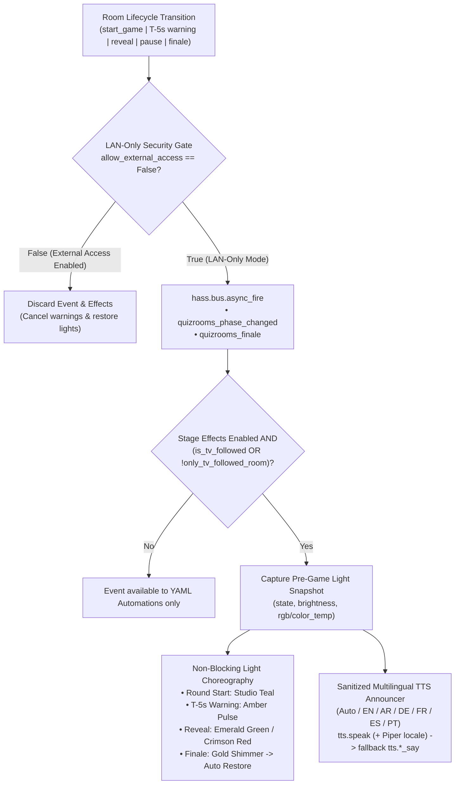

# QuizRooms Architecture & Design

This document describes the end-to-end backend, networking, security, real-time messaging, and gameplay engine architecture of the **QuizRooms** Home Assistant custom integration (`custom_components/quizrooms`).

---

## 1. Design Principles

1. **Local-First & Zero External Dependencies:** No external CDNs, no cloud APIs, no telemetry, and no third-party Python `requirements` in `manifest.json`. Every HTML page, stylesheet, JavaScript module, QR generator, Web Audio synthesizer, local WOFF font file, avatar, pack cover, flag, map silhouette, logo, and diagram SVG (584 SVGs across 37 built-in packs / 3,064 questions) is served locally by Home Assistant.
2. **Defense-in-Depth LAN Isolation:** Guest phones and Smart TVs join without Home Assistant credentials, so every unauthenticated route is strictly protected by a fail-closed `NetworkGuard` allowing only RFC 1918 / IPv6 ULA / link-local / admin-configured CIDRs by default.
3. **Strict Home Assistant Async Compliance:** Zero blocking filesystem I/O inside any `async def` coroutine. Disk scans, pack loading, ZIP imports, asset reads, and media pinning are offloaded via `hass.async_add_executor_job`.
4. **Snapshot Isolation:** Running games snapshot their selected questions and pin referenced media bytes in memory on `start_game`, preventing mid-game pack edits or deletions from disrupting live rooms.
5. **Multi-Room Concurrency & Self-Healing Cleanup:** Multiple independent public/private rooms run concurrently up to `number.quizrooms_max_rooms`, with automatic idle TTL expiration (15 min lobbies, 2 hr active/finished rooms).

---

## 2. High-Level System Architecture



---

## 3. Module Responsibilities

| Module | File | Responsibility |
| --- | --- | --- |
| **Entrypoint** | `custom_components/quizrooms/__init__.py` | Sets up `QuizRoomsCoordinator`, registers HTTP/WS views once, registers custom sidebar icon (`quizrooms:logo`) and Admin Sidebar Panel (`?v=VERSION`), registers HA services, binds dynamic `OptionsFlow` listener, and forwards `number` & `sensor` platforms. |
| **Coordinator** | `custom_components/quizrooms/coordinator.py` | Owns live runtime state, multiplexed WebSocket client registry (`set[WSClient]`), per-room question countdown `asyncio.Task` timers, tracked auto-reveal tasks (cancelled on pause), 60-second TTL cleanup loop, `TVState` synchronization, entity change callbacks, and executor offloading (`async_run_in_executor`). |
| **Game Engine** | `custom_components/quizrooms/engine.py` | Pure domain engine: room creation, 1-room-per-browser enforcement, globally unique preset avatar reservation, difficulty filtering, question snapshotting, 1–N one-time confidence wager pool, blind Final Bonus Round (`PHASE_BONUS_WAGER`), answer evaluation, duplicate-answer rejection, host overrides, leaderboards, finale awards, and anti-leakage state serialization with redacted public player IDs (`plr_<12-hex>`). |
| **Data Models** | `custom_components/quizrooms/models.py` | Typed dataclasses (`Pack`, `Question`, `SnapshotQuestion`, `MediaAsset`, `RoomSettings`, `Room`, `Player`, `PlayerSubmission`). |
| **Pack Registry & Importer** | `custom_components/quizrooms/packs.py` | Loads built-in (`packs/`, 37 packs / 3,064 questions) and custom (`<config>/quizrooms/packs/`) packs, maps media & covers to salted opaque SHA-256 IDs, pins active room media bytes in memory (pruned on room close/shutdown), and securely validates/extracts `.json` and `.zip` uploads. |
| **Normalization** | `custom_components/quizrooms/normalization.py` | Latin + Arabic text normalization (Tashkeel/Tatweel stripping, Alef/Teh Marbuta/Alef Maksura folding, Eastern Arabic/Persian digit conversion, article stripping), Levenshtein + `SequenceMatcher` fuzzy matching, canonical duplicate keys, and Arabic-aware `starts_with` prefix matching. |
| **Avatars** | `custom_components/quizrooms/avatars.py` | Serves 20 bundled studio SVG avatars and validates/stores in-memory custom user photo uploads (bounded body check, magic-byte check for PNG/JPEG/WebP/GIF, max 256 KB, SVG rejected on user upload). |
| **Network Guard** | `custom_components/quizrooms/network_guard.py` | Strict fail-closed LAN access policy with trusted reverse-proxy `X-Forwarded-For` walking, Cloudflare Tunnel (`CF-Connecting-IP`) / Nabu Casa (`X-Hass-Source`) remote detection, and custom CIDR whitelist support. |
| **Smart TV Launcher** | `custom_components/quizrooms/tv_launcher.py` | Discovers connected supported Smart TV `media_player` entities via HA Entity Registry (`webostv`, `androidtv`, `androidtv_remote`, `samsungtv`, `samsungtv_smart`, `samsungtv_tizen`) and dispatches native URL-open commands with fallbacks. |
| **Event Bus & Stage Director** | `custom_components/quizrooms/stage_effects.py` | Builds privacy-safe `quizrooms_phase_changed` & `quizrooms_finale` event payloads, discovers connected `light.*` / `media_player.*` / `tts.*` entities, runs non-blocking RGB/dimmer light presets with pre-game scene snapshot & restoration, and dispatches sanitized multilingual TTS announcements (`auto`, `en`, `ar`, `de`, `fr`, `es`, `pt` + Piper voice/locale mapping & optional predefined volume) — strictly gated on LAN-Only mode. |
| **HTTP & WS Views** | `custom_components/quizrooms/views.py` | Implements all `HomeAssistantView` endpoints, CSWSH-guarded WebSocket routing (`WSClient`), strict sandbox CSP headers for media/avatars, bundled `qrcode.js` + `admin-panel.js` delivery, and Admin APIs (`/api/admin/state`, `/api/admin/stage`, `/api/admin/packs/import`, `/api/admin/packs/{id}/preview`, `/api/admin/open_tv`, etc.). |
| **HA Entities** | `number.py`, `sensor.py` | Exposes `number.quizrooms_max_rooms`, `sensor.quizrooms_active_games`, and `sensor.quizrooms_active_players` grouped under a single Home Assistant `DeviceEntryType.SERVICE` device. |

---

## 4. Game Room State Machine & Scoring Lifecycle

```mermaid
stateDiagram-v2
    [*] --> Lobby: create_room\n(room_code, host_token)

    Lobby --> Lobby: join_room / update_settings / update_avatar
    Lobby --> Question: start_game\n(snapshot questions + optional bonus question,\nfilter difficulty, pin media, init 1..N wager chips)
    Lobby --> Closed: close_room / 15m idle TTL

    Question --> Question: submit_answer (lock answer + wager chip)\npause_room / resume_room
    Question --> Reveal: timer expires OR\nall connected players locked in (+1.1s beat) OR\nhost Reveal Now

    Reveal --> Reveal: override_answer\n(Host/Admin approve or mark wrong\nfor Free-Text / Open-Ended / Duplicate)
    Reveal --> Question: next_step (more regular rounds remaining)
    Reveal --> BonusWager: next_step (regular rounds done & bonus_round=true)
    BonusWager --> BonusWager: submit_bonus_wager (blind ±5..±15 or ±5..±30)
    BonusWager --> Question: all connected players wagered OR\nhost Reveal Bonus Question
    Reveal --> Finale: next_step (last round / bonus complete)

    Finale --> Lobby: play_again\n(reset scores, wagers, bonus_wagers, used_answers;\nkeep players & room code)
    Finale --> Closed: close_room / 2h idle TTL
    Question --> Closed: close_room / 2h idle TTL
    BonusWager --> Closed: close_room / 2h idle TTL
    Reveal --> Closed: close_room / 2h idle TTL
    Closed --> [*]
```



### Confidence Wagering, Blind Bonus Round & Scoring Rules
- **Rounds & Timers:** Regular rounds in multiples of `5` from `5` to `25` (`5, 10, 15, 20, 25`), capped automatically for small custom packs. Question timers support `20`, `30`, `45`, and `60` seconds (`ALLOWED_TIMERS`).
- **One-Time Confidence Wager Pool (`1..N`):** Each player starts with chips `1` through `N` (where `N = regular_rounds`). Each chip can be spent **once** per game. If omitted or if the timer expires unanswered, the player's **lowest available** chip is automatically consumed.
- **Deduction Toggle (`deduct_wrong_wager`):** Default `true`. Correct answers award `+wager`; wrong, duplicate, or timed-out answers score `-wager` when enabled or `0` when disabled.
- **Blind Final Bonus Question (`bonus_round` / `PHASE_BONUS_WAGER`):**
  - When enabled by the host (and an extra unused question exists), an extra `is_bonus=True` question is appended to `room.questions`.
  - After the final regular Reveal, `next_step` enters `PHASE_BONUS_WAGER` where players choose a blind high-stakes wager *before* seeing the bonus question: `5, 10, 15` (for `<= 5` regular rounds) or `5, 10, 15, 20, 25, 30` (for `10–25` regular rounds).
  - Security & fairness guards: boolean values are rejected in wager validation, players cannot re-submit/change their blind wager once locked, and late joiners arriving after the bonus question is already revealed are pinned to the minimum bonus stake (`5`).
  - Bonus scoring always awards `+wager` for correct and `-wager` for wrong/timeout (even if `deduct_wrong_wager` is disabled for regular rounds) and never consumes regular `1..N` chips.
- **No Repeated Answers (`unique_answers_only`):** Auto-enabled for `open_ended: true` packs (toggleable by host). During `reveal_current_question`:
  1. Each submission is mapped to `canonical_duplicate_key(answer)` (normalized + article-stripped so e.g. `القاهرة` and `قاهره` collide).
  2. Any key submitted by **2+ players in the same round** or found in `room.used_answers` from **earlier rounds** is scored as `outcome = "duplicate"` (incorrect) with an explanatory `duplicate_reason`.
  3. All non-empty canonical keys from the round are appended to `room.used_answers`.
  4. The Host or HA Admin may still override any Free-Text / Open-Ended / Duplicate submission during Reveal.

---

## 5. Real-Time WebSocket & TV Synchronization Flow



---

## 6. Security & Network Guard Architecture

```mermaid
flowchart LR
    REQ["Incoming HTTP / WS Request"] --> AUTH{"Authenticated HA User\n(hass_user present)?"}

    AUTH -->|Yes on Admin API| ADMIN{"user.is_admin?"}
    ADMIN -->|Yes| ALLOW_ADMIN["Allow Admin API"]
    ADMIN -->|No| DENY_403A["403 admin_required"]

    AUTH -->|Yes on /media or /avatar| ALLOW_MEDIA["Allow Remote Admin\nPack Covers & Avatars"]

    AUTH -->|No (Unauthenticated Guest / TV)| EXT{"allow_external_access\nenabled in Options?"}
    EXT -->|Yes| ALLOW_PUB["Allow Request"]
    EXT -->|No (Default LAN-Only)| PROXY["Inspect peer IP,\ntrusted_proxies, X-Forwarded-For,\nCF-Connecting-IP, X-Hass-Source"]

    PROXY --> TUNNEL{"Cloudflare Tunnel /\nNabu Casa / Untrusted Proxy?"}
    TUNNEL -->|Yes| DENY_403B["403 local_network_only\n(Fail-Closed)"]
    TUNNEL -->|No| CIDR{"Client IP in RFC 1918 /\nIPv6 ULA / Link-Local /\nallowed_subnets?"}
    CIDR -->|Yes| ALLOW_LAN["Allow LAN Request"]
    CIDR -->|No| DENY_403B
```

### Additional Security & DoS/Leak Controls
- **Frozen Middleware Handling:** Home Assistant freezes `hass.http.app.middlewares` once the HTTP server starts (e.g., when adding an integration via UI). `__init__.py` detects frozen middleware lists gracefully and every unauthenticated `HomeAssistantView` enforces `_check_network_guard(...)` directly as defense-in-depth.
- **Fail-Closed Cloud & Tunnel Guard:** `NetworkGuard` explicitly blocks Nabu Casa (`X-Hass-Source`), Cloudflare Tunnel (`CF-Connecting-IP`, `CF-Ray`), `True-Client-IP`, `X-Real-IP`, and malformed proxy IP headers even when relayed over `127.0.0.1` loopback.
- **WebSocket CSWSH, Connection Caps, Slow-Consumer Eviction & Room Binding:** `/quizrooms/ws` enforces same-origin `Origin` validation (including rejecting sandboxed-iframe `Origin: null`), enforces global (`250`) and per-IP (`40`) socket caps (`429 ws_limit_reached`), applies a `4.0s` send timeout on broadcasts so stalled mobile sockets (`TCP ZeroWindow`) are evicted and closed without stalling timers, and binds each room socket strictly to its `(room_code, session_token)` pair.
- **Bounded Request Streams & Host Header Sanitization:** All JSON POST endpoints enforce a `64 KB` stream limit (`413 payload_too_large`), multipart uploads bound total stream bytes and part counts across all fields, and `resolve_lan_base_url()` validates host/URL syntax to block `Host` header QR poisoning and shell/URL injection.
- **Session Token Redaction & Preset Avatar Anti-Hoarding:** `serialize_room_state()` redacts other players' raw `session_token`s to `plr_<12-hex>`, synchronizes avatars per `session_token` across rooms so one browser cannot hoard multiple preset avatars, and removes non-host guests who leave an unstarted Lobby.
- **Sandboxed Media, Validated Custom SVGs & Bounded Memory:** `/quizrooms/media/{opaque_id}` and `/quizrooms/avatar/{kind}/{id}` serve assets with `Content-Security-Policy: default-src 'none'; sandbox` and `X-Content-Type-Options: nosniff`. Custom `.svg` files in ZIP packs are XML-validated to reject `<!DOCTYPE`/`<!ENTITY`, `<script>`, `<foreignObject>`, and `on*=` handlers. Custom avatars (`<= 100` LRU) and pinned room media are pruned automatically on room close, pack reload/delete, entry reload, and shutdown.
- **Hardened ZIP Pack Importer & Schema Bounds:** Rejects Zip Slip (`..`, absolute paths, Windows backslashes), UNIX symbolic links (`stat.S_IFLNK`), disallowed file extensions, archives exceeding 500 entries / 25 MB upload / 50 MB streamed uncompressed bytes, and excessive question/alias counts that could stall fuzzy matching on the event loop.
- **Anti-Leakage Serialization:** `serialize_room_state()` never sends upcoming questions or the active question's correct answer while `phase == "question"` or `phase == "bonus_wager"`.

---

## 7. Non-Blocking Async Execution Model

Home Assistant's event loop monitors synchronous filesystem calls via `homeassistant.util.loop`. QuizRooms adheres strictly to non-blocking execution:
- `QuizRoomsCoordinator.from_hass(...)` initializes with `load_packs=False`, and `await coordinator.async_initialize()` loads built-in and custom packs inside `hass.async_add_executor_job`.
- All views serving files from disk (`play.html`, `tv.html`, `admin-panel.js` + `qrcode.js`, `sidebar-icon.js`, `/assets/*`, `/media/*`, `/avatar/preset/*`) execute filesystem reads via `coordinator.async_run_in_executor(...)`.
- `async_start_game` offloads `pack_registry.pin_media_for_room(...)` to the executor thread pool, and room closure / shutdown prunes pinned media cleanly.
- Pack import (`POST /api/admin/packs/import`), delete (`DELETE /api/admin/packs/{id}`), and `quizrooms.reload_packs` run entirely in executor threads.

---

## 8. Smart TV Launcher Flow



---

## 9. Home Assistant Event Bus & TV-Synced Smart-Home Stage Effects

QuizRooms integrates directly with Home Assistant's native Event Bus and smart-home devices (`light.*`, `media_player.*`, `tts.*`) to turn the living room into a synchronized game-show studio.



### Security & Reliability Invariants
1. **Strict LAN-Only Kill Switch (`allow_external_access == False`):** If External Access is enabled in Options, `coordinator.is_stage_events_allowed()` returns `False`, immediately discarding all `quizrooms_phase_changed` / `quizrooms_finale` bus emissions and all built-in light/speaker calls, cancelling active countdown warning timers, restoring any snapshotted lights, and locking the Admin Panel Stage Effects UI (`409 stage_effects_disabled_external_mode`).
2. **TV-Followed Room Scoping:** By default (`only_tv_followed_room = true`), built-in Stage Effects only react to the room currently followed on the TV Dashboard (`tv_state.mode == "follow"` and `tv_state.room_code == room.code`). Switching the TV back to `overview` or closing the room immediately restores snapshotted lights. Every HA Event Bus payload also carries `"is_tv_followed": true | false`.
3. **Privacy & Anti-Cheat Payloads:** Event payloads expose non-secret `public_player_id` (`plr_<12-hex>`) rather than raw `session_token`s, and never include `correct_answer` during `phase == "question"`.
4. **TTS Nickname Sanitization, Multilingual Override & Optional Predefined Volume:** `sanitize_tts_name()` strips XML/SSML tags, URLs, and punctuation abuse before calling `tts.speak` (with Piper voice/locale mapping, `google_translate` discovery, and automatic legacy `tts.<provider>_say` fallback). Announcement language defaults to `auto` (matching the pack's language) or can be forced to `en`, `ar`, `de`, `fr`, `es`, or `pt`. When `speaker_volume_enabled` is enabled, `StageDirector` calls `media_player.volume_set` to `speaker_volume` (`0.05`–`1.0`) right before announcing; when disabled, it leaves the speaker's current volume untouched. All `hass.services.async_call(..., blocking=False)` calls run in tracked background tasks with `3.0s` timeouts so offline devices never stall game timers.
5. **Pre-Game Light Scene Snapshot & Non-RGB Degradation:** Before modifying any selected `light.*` entity, `StageDirector` captures its initial `state`, `brightness`, and color attributes (`rgb_color` / `hs_color` / `xy_color` / `color_temp_kelvin`) and restores them after the Finale, on room close, or on TV unfollow. White-only dimmers gracefully receive `brightness_pct` without `rgb_color`.

### Native HA Events Emitted (LAN-Only Mode)
- **`quizrooms_phase_changed`**: Emitted with `sub_event` in `round_start`, `final_countdown` (scheduled via `_warning_timers[code]` at `T-5s`), `round_reveal` (includes `round_result` with `any_correct`, `majority_correct`, `all_correct`, `none_correct`, `round_winner`, `round_top_scorers`, `overall_leader`), `paused`, `resumed`, and `play_again`.
- **`quizrooms_finale`**: Emitted on transition to `phase == "finale"` with `winner`, `co_winners`, `is_tie`, `podium` (top 3), and `awards`.
