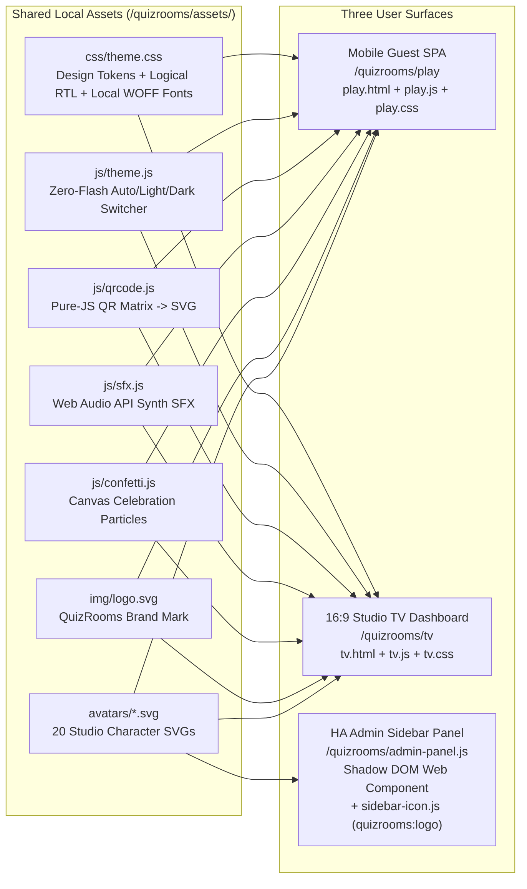
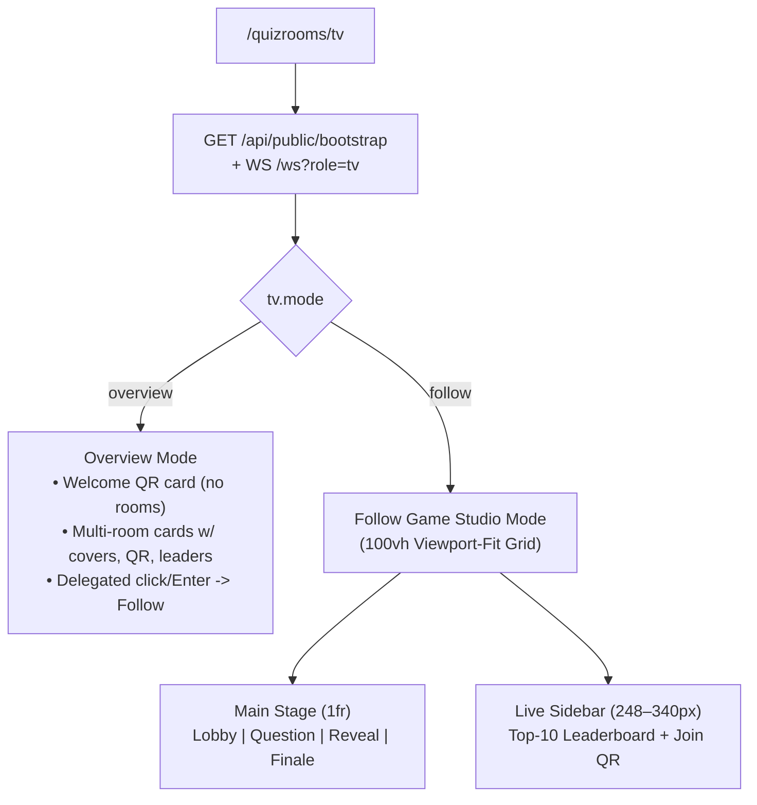

# QuizRooms Frontend UI & Design System

QuizRooms ships **three purpose-built, zero-dependency web interfaces** served directly by Home Assistant with no build pipeline, no npm runtime, and no external network requests.

---

## 1. Frontend Architecture Overview

---

## 2. Visual Design System & Theming

### Neutral Dark-Grey & Warm Light Themes
- **Dark Mode (Neutral Charcoal Studio):** Uses neutral charcoal surfaces (`#121214` canvas, `#1c1c1f` cards, `#26262a` elevated tiles) paired with vibrant teal (`#2dd4bf`), emerald (`#34d399`), amber (`#fbbf24`), and coral (`#fb7185`) accents for high legibility on OLED/LED TVs and phones without blue-cast glare.
- **Light Mode (Warm Studio Paper):** Warm light surface (`#f7f5f0` canvas, `#ffffff` cards, `#f0ece3` controls) with high-contrast indigo (`#4338ca`) and emerald accents.
- **Zero-Flash Bootstrapping:** Inline `<script>` inside `<head>` of `play.html` and `tv.html` reads `localStorage["quizrooms_theme"]` (`auto` | `light` | `dark`) and sets `document.documentElement.dataset.theme` **before** first paint. The Admin panel (`<quizrooms-admin-panel>`) also syncs with Home Assistant's `hass.themes.darkMode` when set to `auto`.

### Full Arabic / RTL Layout Architecture
- **100% Logical CSS Properties:** Spacing, borders, and alignment rely on `margin-inline`, `padding-block`, `border-inline-start`, and `text-align: start` rather than physical left/right offsets.
- **Per-Element Directionality:** Rooms, pack selectors, prompts, choices, reveal boxes, and text inputs apply `dir="rtl"` for RTL packs/questions and `dir="auto"` for user-entered nicknames and free-text answers.
- **Local Bilingual Typography:** Bundles local `.woff` fonts for Latin (`QuizDisplay`), full Arabic regular & bold (`QuizArabic`), and tabular monospace scores/timers (`QuizMono`).

### Scannable QR Codes & Bounded Media Frames
- `.qr-white-frame` enforces a guaranteed `#ffffff` quiet zone in both Light and Dark themes so phone cameras scan reliably in dim living rooms.
- `.media-frame` renders flags and pack visuals inside a neutral bounded frame so white-edged flags (e.g., Japan, Egypt, South Korea) remain crisp against both light and dark backgrounds.

---

## 3. Player Mobile SPA (`/quizrooms/play`)

**Files:** `frontend/play.html`, `frontend/assets/js/play.js`, `frontend/assets/css/play.css`

### Key Flows
1. **Open Lobby & Profile Bar:**
   - Persistent `session_token`, `nickname`, `avatar`, and per-room `host_token`s in `localStorage` allow seamless page reloads and mid-game reconnects.
   - **Avatar Studio Modal:** Players pick from 20 globally-unique studio SVG characters (taken presets show a live `Taken` pill across all active rooms) or upload a custom photo (client-cropped to `160×160` JPEG via `<canvas>` and uploaded to `POST /quizrooms/api/public/avatar`).
   - Displays live open public rooms with pack cover thumbnails, difficulty badges, player counts, and capacity (`active_rooms / max_rooms`).
2. **Create New Room Modal:**
   - Multi-pack checklist with pack cover thumbnails and `Open-Ended` badges.
   - Smart defaults: selecting an open-ended pack (e.g., **أتوبيس كومبليت** or **Autobus Complete**) automatically sets **Answer Mode** to `Free-Text` and checks **No Repeated Answers** (still toggleable by the host).
   - Configurable **Rounds** (`5, 10, 15, 20, 25`), **Question Timer** (`20s, 30s, 45s`), **Difficulty** (`Random`, `Easy`, `Medium`, `Hard`), **Deduct Wager if Wrong** (default on), **Visibility** (`Public`/`Private`), and **Allow Late Joiners**.
3. **Question & Confidence Wager Phase:**
   - Server-synchronized countdown bar (`requestAnimationFrame` corrected via `server_now_ms` clock offset).
   - Tap-to-zoom lightbox on flag/photo visuals.
   - Prominent starting-letter pill (`يبدأ بحرف` / `Starts with`) for open-ended letter rounds.
   - **One-Time Wager Chips (`1..N`):** Defaults to the lowest remaining chip; already-spent chips appear disabled with strikethrough.
   - Independent Web Audio SFX toggle (`Sound: On/Off`, persisted under `quizrooms_sound_play`).
4. **Reveal & Finale Phases:**
   - Color-coded outcome rows (`correct`, `wrong`, `duplicate` amber highlight with reason, `timeout`), confetti + victory chime on correct reveals, Host **Approve / Mark Wrong** override controls, and 3-tier Podium + Superlative Awards (`High Roller`, `Safe Player`, `Streak Master`, `Sharpest Mind`).

---

## 4. 16:9 Studio TV Dashboard (`/quizrooms/tv`)

**Files:** `frontend/tv.html`, `frontend/assets/js/tv.js`, `frontend/assets/css/tv.css`

### Smart TV Engineering Highlights
- **Full HD (1080p), 720p-CSS Smart TV, & 4K Scaling:** On viewports `>= 960px`, `.tv-shell` locks to `height: 100vh; overflow: hidden;` and scales header, timer, flag showcase, question typography, 2×2 choice grid, player lock-in pills, reveal outcomes, podium, and sidebar QR frame proportionally using `vh` and `clamp(...)` (with pre-`clamp()` fallback declarations for older Chromium 68 engines like LG webOS 5).
- **LG webOS TV SVG Compatibility:** All 197 bundled flag SVGs declare explicit `width="640" height="480"` attributes matching their `viewBox`, and `.tv-media-showcase .media-frame img` defines explicit `height` + `width: auto` so older Blink/Chromium browsers never collapse SVG flags to `0px` inside flex containers.
- **Clean Studio Header:** Displays only the QuizRooms brand mark, title, live connection badge, `All Rooms` toggle (in Follow mode), independent TV `Sound: On/Off` toggle (`quizrooms_sound_tv`), and theme pill—without cluttering the screen with raw Home Assistant URLs.
- **Resilient TV Controls:** Uses event delegation on `#tv-main` so remote-control clicks work across live re-renders, plus an HTTP fallback (`POST /quizrooms/api/public/tv_mode`) and 4.5-second bootstrap polling if a Smart TV browser drops WebSocket connectivity.

---

## 5. Home Assistant Admin Sidebar Panel

**Files:** `frontend/admin-panel.js`, `frontend/sidebar-icon.js`

- **Custom Sidebar Icon:** `sidebar-icon.js` registers the `quizrooms:logo` custom icon set with `window.customIcons` so the QuizRooms vector logo appears natively in Home Assistant's left navigation rail.
- **Encapsulated Web Component:** `<quizrooms-admin-panel>` renders inside an open Shadow DOM, authenticating every API call with `hass.fetchWithAuth(...)` and invoking Home Assistant services via `hass.callService(...)`.
- **Control Modules:**
  1. **KPI Strip:** Live active rooms/limit, connected players, loaded packs count, and Network Guard status.
  2. **Active Rooms Monitor:** Lists both public and private rooms with cover thumbnails, player avatar pills & scores, `Start`, `Pause/Resume`, `Advance`, `Follow on TV`, and `Force Close` controls, plus `number.quizrooms_max_rooms` editor.
  3. **TV Dashboard Remote & Smart TV Launcher:** Switches Overview/Follow mode, pushes TV theme overrides, and lists **only currently connected supported Smart TV `media_player`s** (`webostv`, `androidtv`, `androidtv_remote`, `samsungtv`, `samsungtv_smart`, `samsungtv_tizen`) with one-click **Open Dashboard**.
  4. **Drag-and-Drop Pack Importer & Installed Packs:** Live `.json`/`.zip` upload with validation feedback, overwrite option, downloadable sample template, collapsible format documentation, and installed pack management (built-in packs protected from deletion).
