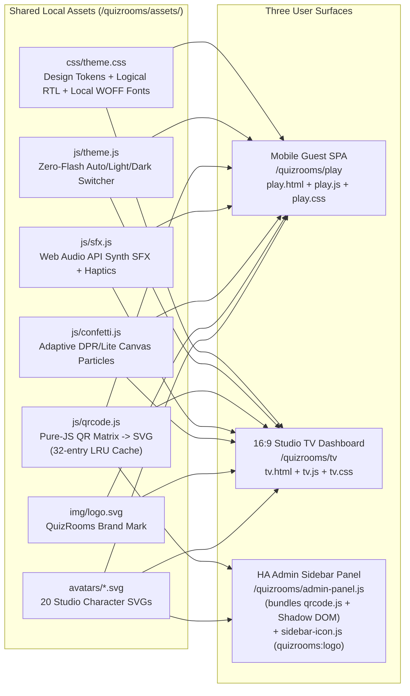
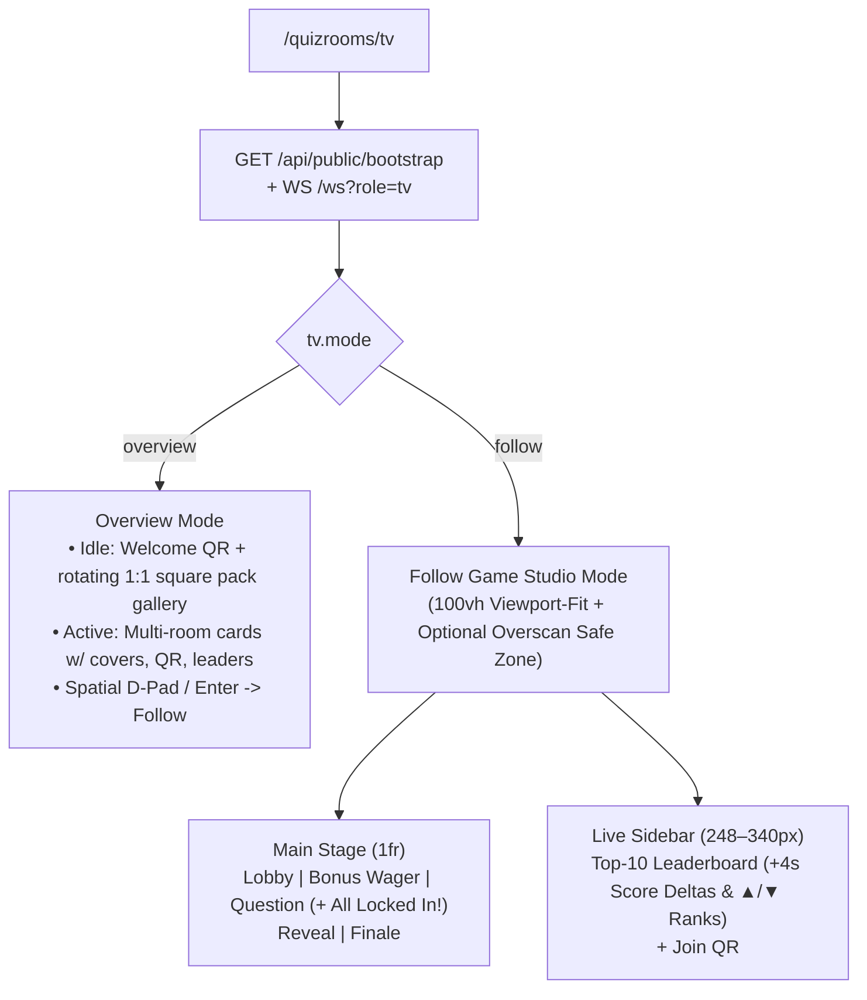

# QuizRooms Frontend UI & Design System

QuizRooms ships **three purpose-built, zero-dependency web interfaces** served directly by Home Assistant with no build pipeline, no npm runtime, and no external network requests.

---

## 1. Frontend Architecture Overview

---

## 2. Visual Design System & Theming

### Neutral Dark-Grey & Warm Light Themes
- **Dark Mode (Neutral Charcoal Studio):** Uses neutral charcoal surfaces (`#121214` canvas, `#1c1c1f` cards, `#26262a` elevated tiles) paired with vibrant teal (`#2dd4bf`), emerald (`#34d399`), amber (`#fbbf24`), and coral (`#fb7185`) accents for high legibility on OLED/LED TVs and phones without blue-cast glare.
- **Light Mode (Warm Studio Paper):** Warm light surface (`#f7f5f0` canvas, `#ffffff` cards, `#f0ece3` controls) with high-contrast indigo (`#4338ca`) and emerald accents.
- **Zero-Flash Bootstrapping & Hardware Lite-Mode Detection:** Inline `<script>` inside `<head>` of `play.html` and `tv.html` reads `localStorage["quizrooms_theme"]` (`auto` | `light` | `dark`) and sets `document.documentElement.dataset.theme` **before** first paint. `tv.html` also restores `quizrooms_tv_overscan` and sets `data-tv-perf="lite"` on legacy Smart TVs (`Web0S`/`webOS`/`Tizen`/`SMART-TV` or Chrome `< 80`), while `play.html` sets `data-mobile-perf="lite"` on low-RAM / older mobile devices (`deviceMemory <= 3`, `hardwareConcurrency <= 4`, `saveData`, Chrome `< 85`, or iOS `< 14`). The Admin panel (`<quizrooms-admin-panel>`) syncs with Home Assistant's `hass.themes.darkMode` when set to `auto`.

### Full Arabic / RTL Layout Architecture
- **100% Logical CSS Properties:** Spacing, borders, and alignment rely on `margin-inline`, `padding-block`, `border-inline-start`, and `text-align: start` rather than physical left/right offsets.
- **Per-Element Directionality:** Rooms, pack selectors, prompts, choices, reveal boxes, and text inputs apply `dir="rtl"` for RTL packs/questions and `dir="auto"` for user-entered nicknames and free-text answers.
- **Local Bilingual Typography & `unicode-range` Subsetting:** Bundles local `.woff` fonts only (no unbundled `.woff2` references) for Latin (`QuizDisplay` — Ubuntu), full Arabic regular & bold (`QuizArabic` — DejaVu Sans), and tabular monospace scores/timers (`QuizMono` — Noto Sans Mono). `@font-face` declarations specify `unicode-range` blocks so English-only devices skip downloading 714 KB of Arabic font files until Arabic characters are rendered, and `?v=` versioned assets are cached with `Cache-Control: public, max-age=31536000, immutable`.

### Scannable QR Codes & Bounded Media Frames
- `.qr-white-frame` enforces a guaranteed `#ffffff` quiet zone in both Light and Dark themes so phone cameras scan reliably in dim living rooms.
- `.media-frame` renders flags, maps, logos, and diagrams inside a neutral bounded frame so white-edged visuals (e.g., Japan, Egypt, South Korea flags) remain crisp against both light and dark backgrounds.

---

## 3. Player Mobile SPA (`/quizrooms/play`)

**Files:** `frontend/play.html`, `frontend/assets/js/play.js`, `frontend/assets/css/play.css`, `frontend/assets/js/sfx.js`

### Key Flows & Mobile Ergonomics
1. **Open Lobby & Profile Bar:**
   - Persistent `session_token`, `nickname`, `avatar`, and per-room `host_token`s in `localStorage` allow seamless page reloads and mid-game reconnects.
   - **Non-Destructive Reconnect Banner (`#reconnect-banner`):** If mobile Wi-Fi drops briefly mid-round, displays an unobtrusive top banner (`Reconnecting to room Q7KM…`) while preserving any typed free-text answer draft, cursor position, and selected wager chip.
   - **Avatar Studio Modal:** Players pick from 20 globally-unique studio SVG characters (taken presets show a live `Taken` pill across all active rooms, diff-gated so unrelated lobby updates do not redraw the grid) or upload a custom photo (downscaled during decode via `createImageBitmap(..., { resizeWidth: 320 })` with safe `Image` fallback, cropped to `160×160` JPEG via `<canvas>`, and cleaned up immediately to prevent OOM spikes on 2–3 GB RAM phones).
   - Displays live open public rooms with lazy-decoded pack cover thumbnails, difficulty badges, bonus/unique indicators, player counts, and capacity (`active_rooms / max_rooms`).
2. **Create New Room Modal:**
   - Starts with **no packs selected by default** (`0 selected`), with `120ms` debounced live search (`#cr-pack-search`), lazy/async pack cover thumbnails (`loading="lazy" decoding="async"`), delegated checkbox/chip listeners, and filter pills (`All`, `EN`, `AR (عربي)`, any extra custom-pack language, `Open-Ended`, and `🧸 Kids (3–4)`). Adult filters (`All`, `EN`, `AR`) isolate Kids packs so party game nights stay clutter-free while the `🧸 Kids (3–4)` pill reveals all 11 early-learning packs plus a **🎲 Random Kids Packs** picker.
   - **Per-Language Random Pack Picker (`🎲 Random <LANG> Packs`):** Shown on language filters and `🧸 Kids (3–4)` (hidden on `All` and `Open-Ended`). Each click deselects all previous selections, picks up to 3 fresh packs from that category, floats them to the top of the list, and updates the live **Selected Packs chip bar** (`#cr-selected-summary`) with per-pack `×` remove buttons and **Clear all**.
   - Smart defaults: selecting an open-ended pack automatically sets **Answer Mode** to `Free-Text` and reveals/checks **No Repeated Answers** (which stays hidden in `Multiple Choice` mode); selecting any `audience: "kids"` pack automatically checks **🧸 Kids Mode (Ages 3–4)**, defaults **Question Timer** to `No Timer (Relaxed)`, and exposes **Gentle Try Again** and **Auto-Advance on Reveal (3s)** while hiding wager/bonus/free-text controls.
   - Configurable **Rounds** (`5, 10, 15, 20, 25`), **Question Timer** (`No Timer`, `20s, 30s, 45s, 60s`), **Difficulty** (`Random`, `Easy`, `Medium`, `Hard`), **Deduct Wager if Wrong** (default on), **Visibility** (`Public`/`Private`), **Allow Late Joiners**, and **★ Final Bonus Question** (`±5–15` or `±5–30` pts).
3. **Blind Final Bonus Wager, Kids Mode & Question Phase:**
   - **Kids Mode One-Tap Visual Experience:** Hides the wager selector and sticky Lock-In bar so tapping any giant, brightly tinted tile (`large_glyph`, `color_swatch`, or `image_grid` with zero `A/B/C/D` key prefixes) submits immediately. Includes a **🔊 Listen** button + optional **Auto-Read** toggle powered by zero-dependency browser `window.speechSynthesis` (selecting `en-*` or `ar-*` voices automatically), a gentle wobble/dim + soft marimba chime (`sfx.softTry()`) when **Try Again** is enabled, Star (`⭐`) score counters, an `Auto-Next (3s)…` celebration banner on Reveal when Auto-Advance is enabled, and a **Parent Guard** confirmation modal before leaving an active Kids game.
   - **Persistent Screen Shells (Zero Mid-Round DOM Wipes):** Open Lobby, Room Lobby, Bonus Wager, and Question screens mount once per state key and patch only counters, headers, or rosters when opponents lock in or join — eliminating dropped taps, repeated `.animate-in` flashes, lost lobby input focus, and mobile virtual keyboard / Arabic IME flicker during Free-Text rounds.
   - **Sticky Bottom Action Bar & Instant Touch:** Pins the primary **Lock In Answer** button (`position: sticky; inset-block-end: 0; padding-block-end: calc(12px + env(safe-area-inset-bottom, 0px))`) and applies `touch-action: manipulation` across buttons and chips for zero-delay taps and double-tap lock-in. On mobile/touch viewports (`<= 820px` or coarse pointer) and `html[data-mobile-perf="lite"]`, cards and sticky bars use solid theme surfaces (`backdrop-filter: none`, `background-attachment: scroll`) for smooth 60fps scrolling and low battery heat.
   - **Smart Wager Chips (`1..N`):** Defaults to lowest remaining chip, displays a live risk hint (`Risking +7 / −7` or `Risking +7 / 0`), separates `High / Mid / Low` tiers when `N >= 15`, and supports tap-again fast confirm on an already-selected chip or choice.
   - **Haptics + Web Audio SFX:** `sfx.js` pairs subtle `navigator.vibrate()` pulses (`choiceTap`, `wagerClick`, `lockIn`, `tickUrgent`, `correct`, `wrong`) with optional Web Audio sound (`Sound: On/Off`, persisted under `quizrooms_sound_play`).
   - **GPU-Composited Throttled Timer & Fast Resume:** Server-synchronized countdown bar driven at 8–10 Hz (`100–125ms` `setInterval`) via GPU-composited `transform: scaleX(...)` (LTR & RTL origin-aware) with cached DOM refs and 1 Hz digit/urgency updates, WS-first startup hydration (`800ms` HTTP bootstrap fallback), `visibilitychange` + `online` instant reconnects, tap-to-zoom lightbox on visuals, and prominent starting-letter pill (`يبدأ بحرف` / `Starts with`).
4. **Safe Room Close, Reveal & Finale Phases:**
   - Moves the host **Close Room** action out of the top header into a dedicated bottom room-footer zone protected by an explicit confirmation modal so hosts never accidentally end a live game.
   - Color-coded outcome rows (`correct`, `wrong`, `duplicate` amber highlight with reason, `timeout`), adaptive confetti (capped on low-RAM phones with automatic `#confetti-canvas` removal on completion) + victory chime on correct reveals, Host **Approve / Mark Wrong** override controls, and 3-tier Podium + Superlative Awards (`High Roller`, `Safe Player`, `Streak Master`, `Sharpest Mind`).

---

## 4. 16:9 Studio TV Dashboard (`/quizrooms/tv`)

**Files:** `frontend/tv.html`, `frontend/assets/js/tv.js`, `frontend/assets/css/tv.css`

### Smart TV Engineering Highlights
- **Full HD (1080p), 720p-CSS Smart TV, & 4K Scaling:** On viewports `>= 960px`, `.tv-shell` locks to `height: 100vh; overflow: hidden;` with `box-sizing: border-box` and scales proportionally using `vh` and `clamp(...)` (with pre-`clamp()` fallback declarations for older Chromium 68 engines like LG webOS 5).
- **TV Safe-Zone / Overscan Padding Toggle:** Header button (`Safe Zone: Off/On`, persisted under `quizrooms_tv_overscan`) combines `env(safe-area-inset-*)` with a ~`3.2%` bezel-safe margin so older TVs never clip header badges or the sidebar QR frame.
- **D-Pad / TV Remote Navigation:** High-contrast amber `:focus-visible` outlines and spatial `ArrowLeft`/`ArrowRight`/`ArrowUp`/`ArrowDown` navigation across header controls and Overview room cards (preserving focused cards across live `lobby_update` refreshes), plus Back/Return (`Escape`, `Backspace`, LG webOS `461`, Samsung Tizen `10009`) to return to Overview.
- **Persistent Follow-Mode DOM & Memoized QR SVGs:** `.tv-follow-layout` mounts once per `room.code` (keeping `.tv-sidebar` and the Join QR mounted, backed by `QuizRoomsQR.toSVG()`'s 32-entry LRU cache). Same-round player lock-ins patch only `#tv-lock-grid` and `#tv-all-locked-banner`, while `#tv-leaderboard-list` updates are diff-gated via `lbSig` — reducing transition latency on ~2017 LG webOS 3.5 TVs from 1–3s to ~100–250ms.
- **GPU-Composited 10 Hz Timer & Legacy Smart TV Lite Mode (`data-tv-perf="lite"`):** Uses a `100–125ms` `setInterval` driving `transform: scaleX(...)` (LTR & RTL origin-aware) with cached DOM refs and 1 Hz digit updates, solid `.studio-card` surfaces (`backdrop-filter: none`, `background-attachment: scroll`), lightweight opacity/color urgency pulses, `decoding="async"` on images, and capped TV confetti (`dpr=1`, `28` particles, `65` frames + canvas cleanup).
- **Reveal Drama & Urgency Polish:**
  - Final 5 seconds pulse the timer digits and progress bar amber → coral with a lightweight urgency cue (`prefers-reduced-motion` and `data-tv-perf="lite"` aware).
  - Displays a crisp **"All Locked In!"** transition banner (EN & AR RTL) during the `0.7s` beat before Reveal.
  - Top-10 sidebar leaderboard displays animated `+N`/`−N` score delta pills and `▲`/`▼` rank movement arrows for ~4 seconds on Reveal (including host override recalculations).
- **Idle / Attract Screen Showcase & Kids Mode Studio Display:** When no rooms are active, rotates 4 installed packs every 6 seconds in a gallery of full **1:1 square (`160×160`) cover cards** (tagged `🧸 3–4` for Kids packs) below the Join QR welcome banner without flickering the QR code. When following a Kids Mode room, `/tv` hides the countdown bar on untimed rounds (skipping `startTimerLoop()`), displays Star (`⭐`) scores and `+1 ⭐` deltas in the sidebar, renders rich `large_glyph`, `color_swatch`, and `image_grid` (`140×140` explicit-dimension SVGs) tiles without `A/B/C/D` prefixes, and celebrates with `reveal_message` on Reveal.
- **LG webOS TV SVG Compatibility:** All 813 bundled SVGs (flags, maps, logos, covers, Kids early-learning illustrations, diagrams, avatars) declare explicit `width` and `height` attributes matching their `viewBox`, and `.tv-media-showcase .media-frame img` / `.tv-choice-img` define explicit dimensions so older Blink/Chromium browsers never collapse SVGs to `0px`.
- **Resilient TV Controls & WS Diagnostics:** Uses event delegation on `#tv-main`, an HTTP fallback (`POST /quizrooms/api/public/tv_mode`), and `2.0s` disconnected bootstrap polling if a Smart TV browser drops WebSocket connectivity, updating `#tv-conn-badge` to `"HTTP Sync (WS Offline)"` with a plain-LAN `http://` hint tooltip after 2+ WS failures.

---

## 5. Home Assistant Admin Sidebar Panel

**Files:** `frontend/admin-panel.js` (served bundled with `frontend/assets/js/qrcode.js`), `frontend/sidebar-icon.js`

- **Custom Sidebar Icon:** `sidebar-icon.js` registers the `quizrooms:logo` custom icon set with `window.customIcons` so the QuizRooms vector logo appears natively in Home Assistant's left navigation rail.
- **Encapsulated Shadow DOM Web Component:** `<quizrooms-admin-panel>` authenticates every API call with `hass.fetchWithAuth(...)` and invokes Home Assistant services via `hass.callService(...)`.
- **Pinned KPI Strip + 3-Tab Workspace (with Header Version Badge):**
  - **Header & Pinned KPI Strip:** Displays the live integration version badge (`v1.0.x`), active rooms/limit, connected players, loaded packs count, and Network Guard status across a single-row 3-column mobile-friendly tab bar (`Live & TV`, `Stage`, `Packs`).
  - **Tab 1 — Live Rooms & TV:**
    - Active Rooms Monitor for both public and private rooms with cover thumbnails, player avatar pills & scores, `Start`, `Pause/Resume`, `Advance`, `Follow on TV`, `Force Close`, inline **Show Join QR** popover (rendered locally via bundled `qrcode.js`), and `number.quizrooms_max_rooms` editor.
    - TV Dashboard Remote & Smart TV Launcher listing **only currently connected supported Smart TV `media_player`s** (`webostv`, `androidtv`, `androidtv_remote`, `samsungtv`, `samsungtv_smart`, `samsungtv_tizen`) with one-click **Open Dashboard**.
  - **Tab 2 — Stage Effects (LAN-Only):**
    - Poll-isolated container with `_fetchSeq` / `_savingStage` guards so 4-second background polls never overwrite in-progress filtered edits or close open dropdowns.
    - **Dirty-State Guard:** Unsaved indicator dot on the tab, accented pulsing **Save Stage Settings** button, and a **Discard / Reset** button.
    - **Stage Lights (`light.*`):** Dedicated **Selected Lights** summary chip strip (name, `RGB`/`Dimmer`/`Switch`/`Offline` badge, individual `×` remove, and **Clear all**) above a stable non-jumping filterable checklist.
    - **Multilingual Speaker Announcer (`media_player.*` + `tts.*`):** Supports `Auto`, `English`, `Arabic`, `German`, `French`, `Spanish`, and `Portuguese`, optional predefined volume slider (`5%–100%` + quick presets), instant test buttons, and an automatic lock banner whenever External Access is enabled.
  - **Tab 3 — Packs & Import:**
    - Drag-and-drop `.json`/`.zip` pack uploader with validation feedback, overwrite option, downloadable sample template, and collapsible schema guide.
    - **Installed Packs Manager:** Responsive 2-column card grid on wide screens (`>= 820px`), live search box, `All / Built-in / Custom / 🧸 Kids` filter pills, `🧸 Ages 3–4` pack badges, built-in deletion protection, and an expandable full-width **Preview Questions** drawer (`GET /quizrooms/api/admin/packs/{pack_id}/preview`) displaying difficulty breakdown (`Easy / Medium / Hard`), choice thumbnails, and sample questions.
