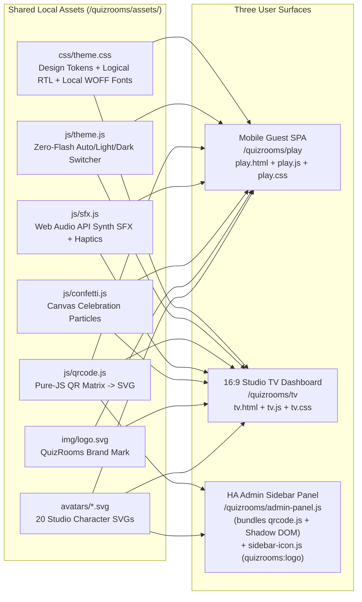
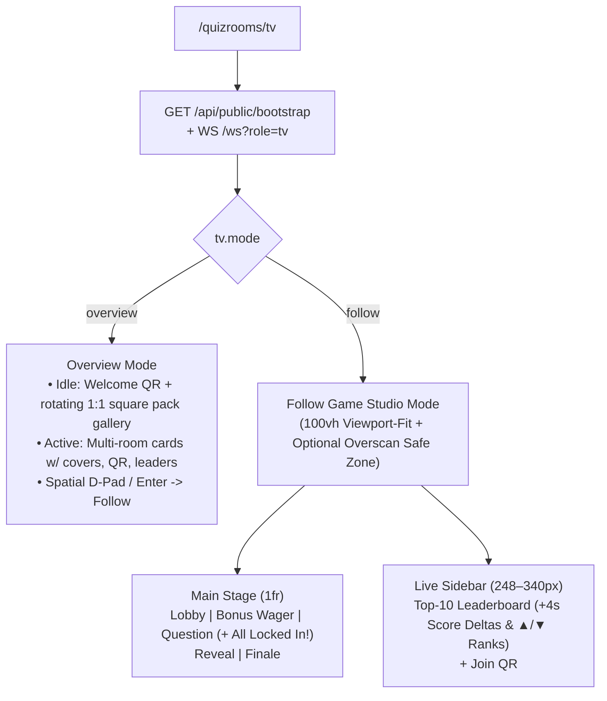

# QuizRooms Frontend UI & Design System

QuizRooms ships **three purpose-built, zero-dependency web interfaces** served directly by Home Assistant with no build pipeline, no npm runtime, and no external network requests.

---

## 1. Frontend Architecture Overview

---

## 2. Visual Design System & Theming

### Neutral Dark-Grey & Warm Light Themes
- **Dark Mode (Neutral Charcoal Studio):** Uses neutral charcoal surfaces (`#121214` canvas, `#1c1c1f` cards, `#26262a` elevated tiles) paired with vibrant teal (`#2dd4bf`), emerald (`#34d399`), amber (`#fbbf24`), and coral (`#fb7185`) accents for high legibility on OLED/LED TVs and phones without blue-cast glare.
- **Light Mode (Warm Studio Paper):** Warm light surface (`#f7f5f0` canvas, `#ffffff` cards, `#f0ece3` controls) with high-contrast indigo (`#4338ca`) and emerald accents.
- **Zero-Flash Bootstrapping:** Inline `<script>` inside `<head>` of `play.html` and `tv.html` reads `localStorage["quizrooms_theme"]` (`auto` | `light` | `dark`) and sets `document.documentElement.dataset.theme` **before** first paint (and `tv.html` also restores `quizrooms_tv_overscan` before first paint). The Admin panel (`<quizrooms-admin-panel>`) syncs with Home Assistant's `hass.themes.darkMode` when set to `auto`.

### Full Arabic / RTL Layout Architecture
- **100% Logical CSS Properties:** Spacing, borders, and alignment rely on `margin-inline`, `padding-block`, `border-inline-start`, and `text-align: start` rather than physical left/right offsets.
- **Per-Element Directionality:** Rooms, pack selectors, prompts, choices, reveal boxes, and text inputs apply `dir="rtl"` for RTL packs/questions and `dir="auto"` for user-entered nicknames and free-text answers.
- **Local Bilingual Typography:** Bundles local `.woff` fonts only (no unbundled `.woff2` references) for Latin (`QuizDisplay` — Ubuntu), full Arabic regular & bold (`QuizArabic` — DejaVu Sans), and tabular monospace scores/timers (`QuizMono` — Noto Sans Mono).

### Scannable QR Codes & Bounded Media Frames
- `.qr-white-frame` enforces a guaranteed `#ffffff` quiet zone in both Light and Dark themes so phone cameras scan reliably in dim living rooms.
- `.media-frame` renders flags, maps, logos, and diagrams inside a neutral bounded frame so white-edged visuals (e.g., Japan, Egypt, South Korea flags) remain crisp against both light and dark backgrounds.

---

## 3. Player Mobile SPA (`/quizrooms/play`)

**Files:** `frontend/play.html`, `frontend/assets/js/play.js`, `frontend/assets/css/play.css`, `frontend/assets/js/sfx.js`

### Key Flows & Mobile Ergonomics
1. **Open Lobby & Profile Bar:**
   - Persistent `session_token`, `nickname`, `avatar`, and per-room `host_token`s in `localStorage` allow seamless page reloads and mid-game reconnects.
   - **Non-Destructive Reconnect Banner (`#reconnect-banner`):** If mobile Wi-Fi drops briefly mid-round, displays an unobtrusive top banner (`Reconnecting to room Q7KM…`) while preserving any typed free-text answer draft, cursor position, and selected wager chip.
   - **Avatar Studio Modal:** Players pick from 20 globally-unique studio SVG characters (taken presets show a live `Taken` pill across all active rooms) or upload a custom photo (client-cropped to `160×160` JPEG via `<canvas>` and uploaded to `POST /quizrooms/api/public/avatar`).
   - Displays live open public rooms with pack cover thumbnails, difficulty badges, bonus/unique indicators, player counts, and capacity (`active_rooms / max_rooms`).
2. **Create New Room Modal:**
   - Starts with **no packs selected by default** (`0 selected`), with live search (`#cr-pack-search`) and filter pills (`All`, `EN`, `AR (عربي)`, any extra custom-pack language, and `Open-Ended`).
   - **Per-Language Random Pack Picker (`🎲 Random <LANG> Packs`):** Shown only on language filters (hidden on `All` and `Open-Ended`). Each click deselects all previous selections, picks up to 3 fresh standard packs from that language, floats them to the top of the list, and updates the live **Selected Packs chip bar** (`#cr-selected-summary`) with per-pack `×` remove buttons and **Clear all**.
   - Smart defaults: selecting an open-ended pack (e.g., **أتوبيس كومبليت** or **Autobus Complete**) automatically sets **Answer Mode** to `Free-Text` and checks **No Repeated Answers** (still toggleable by the host).
   - Configurable **Rounds** (`5, 10, 15, 20, 25`), **Question Timer** (`20s, 30s, 45s, 60s`), **Difficulty** (`Random`, `Easy`, `Medium`, `Hard`), **Deduct Wager if Wrong** (default on), **Visibility** (`Public`/`Private`), **Allow Late Joiners**, and **★ Final Bonus Question** (`±5–15` or `±5–30` pts).
3. **Blind Final Bonus Wager & Question Phase:**
   - **Sticky Bottom Action Bar:** Pins the primary **Lock In Answer** button (`position: sticky; inset-block-end: 0; padding-block-end: calc(12px + env(safe-area-inset-bottom, 0px))`) for effortless one-handed thumb play on smaller phones.
   - **Smart Wager Chips (`1..N`):** Defaults to lowest remaining chip, displays a live risk hint (`Risking +7 / −7` or `Risking +7 / 0`), separates `High / Mid / Low` tiers when `N >= 15`, and supports tap-again fast confirm on an already-selected chip or choice.
   - **Haptics + Web Audio SFX:** `sfx.js` pairs subtle `navigator.vibrate()` pulses (`choiceTap`, `wagerClick`, `lockIn`, `tickUrgent`, `correct`, `wrong`) with optional Web Audio sound (`Sound: On/Off`, persisted under `quizrooms_sound_play`).
   - Server-synchronized countdown bar (`requestAnimationFrame` corrected via `server_now_ms` clock offset), tap-to-zoom lightbox on visuals, and prominent starting-letter pill (`يبدأ بحرف` / `Starts with`).
4. **Safe Room Close, Reveal & Finale Phases:**
   - Moves the host **Close Room** action out of the top header into a dedicated bottom room-footer zone protected by an explicit confirmation modal so hosts never accidentally end a live game.
   - Color-coded outcome rows (`correct`, `wrong`, `duplicate` amber highlight with reason, `timeout`), confetti + victory chime on correct reveals, Host **Approve / Mark Wrong** override controls, and 3-tier Podium + Superlative Awards (`High Roller`, `Safe Player`, `Streak Master`, `Sharpest Mind`).

---

## 4. 16:9 Studio TV Dashboard (`/quizrooms/tv`)

**Files:** `frontend/tv.html`, `frontend/assets/js/tv.js`, `frontend/assets/css/tv.css`

### Smart TV Engineering Highlights
- **Full HD (1080p), 720p-CSS Smart TV, & 4K Scaling:** On viewports `>= 960px`, `.tv-shell` locks to `height: 100vh; overflow: hidden;` with `box-sizing: border-box` and scales proportionally using `vh` and `clamp(...)` (with pre-`clamp()` fallback declarations for older Chromium 68 engines like LG webOS 5).
- **TV Safe-Zone / Overscan Padding Toggle:** Header button (`Safe Zone: Off/On`, persisted under `quizrooms_tv_overscan`) combines `env(safe-area-inset-*)` with a ~`3.2%` bezel-safe margin so older TVs never clip header badges or the sidebar QR frame.
- **D-Pad / TV Remote Navigation:** High-contrast amber `:focus-visible` outlines and spatial `ArrowLeft`/`ArrowRight`/`ArrowUp`/`ArrowDown` navigation across header controls and Overview room cards (preserving focused cards across live `lobby_update` refreshes), plus Back/Return (`Escape`, `Backspace`, LG webOS `461`, Samsung Tizen `10009`) to return to Overview.
- **Reveal Drama & Urgency Polish:**
  - Final 5 seconds pulse the timer digits and progress bar amber → coral with a subtle stage border glow (`prefers-reduced-motion` aware).
  - Displays a crisp **"All Locked In!"** transition banner (EN & AR RTL) during the 1.1s beat before Reveal.
  - Top-10 sidebar leaderboard displays animated `+N`/`−N` score delta pills and `▲`/`▼` rank movement arrows for ~4 seconds on Reveal (including host override recalculations).
- **Idle / Attract Screen Showcase:** When no rooms are active, rotates 4 installed packs every 6 seconds in a gallery of full **1:1 square (`160×160`) cover cards** below the Join QR welcome banner without flickering the QR code.
- **LG webOS TV SVG Compatibility:** All 584 bundled SVGs (flags, maps, logos, covers, diagrams, avatars) declare explicit `width` and `height` attributes matching their `viewBox`, and `.tv-media-showcase .media-frame img` defines explicit `height` + `width: auto` so older Blink/Chromium browsers never collapse SVGs to `0px`.
- **Resilient TV Controls:** Uses event delegation on `#tv-main`, an HTTP fallback (`POST /quizrooms/api/public/tv_mode`), and 4.5-second bootstrap polling if a Smart TV browser drops WebSocket connectivity.

---

## 5. Home Assistant Admin Sidebar Panel

**Files:** `frontend/admin-panel.js` (served bundled with `frontend/assets/js/qrcode.js`), `frontend/sidebar-icon.js`

- **Custom Sidebar Icon:** `sidebar-icon.js` registers the `quizrooms:logo` custom icon set with `window.customIcons` so the QuizRooms vector logo appears natively in Home Assistant's left navigation rail.
- **Encapsulated Shadow DOM Web Component:** `<quizrooms-admin-panel>` authenticates every API call with `hass.fetchWithAuth(...)` and invokes Home Assistant services via `hass.callService(...)`.
- **Pinned KPI Strip + 3-Tab Workspace:**
  - **Pinned KPI Strip:** Live active rooms/limit, connected players, loaded packs count, and Network Guard status remain visible across tabs.
  - **Tab 1 — Live Rooms & TV:**
    - Active Rooms Monitor for both public and private rooms with cover thumbnails, player avatar pills & scores, `Start`, `Pause/Resume`, `Advance`, `Follow on TV`, `Force Close`, inline **Show Join QR** popover (rendered locally via bundled `qrcode.js`), and `number.quizrooms_max_rooms` editor.
    - TV Dashboard Remote & Smart TV Launcher listing **only currently connected supported Smart TV `media_player`s** (`webostv`, `androidtv`, `androidtv_remote`, `samsungtv`, `samsungtv_smart`, `samsungtv_tizen`) with one-click **Open Dashboard**.
  - **Tab 2 — Stage Effects (LAN-Only):**
    - Poll-isolated container with `_fetchSeq` / `_savingStage` guards so 4-second background polls never overwrite in-progress filtered edits or close open dropdowns.
    - **Dirty-State Guard:** Unsaved indicator dot on the tab, accented pulsing **Save Stage Settings** button, and a **Discard / Reset** button.
    - **Stage Lights (`light.*`):** Dedicated **Selected Lights** summary chip strip (name, `RGB`/`Dimmer`/`Switch`/`Offline` badge, individual `×` remove, and **Clear all**) above a stable non-jumping filterable checklist.
    - **Multilingual Speaker Announcer (`media_player.*` + `tts.*`):** Supports `Auto`, `English`, `Arabic`, `German`, `French`, `Spanish`, and `Portuguese`, optional predefined volume slider (`5%–100%` + quick presets), instant test buttons, and an automatic lock banner whenever External Access is enabled.
  - **Tab 3 — Packs & Import:**
    - Drag-and-drop `.json`/`.zip` pack uploader with validation feedback, overwrite option, downloadable sample template, and collapsible schema guide.
    - **Installed Packs Manager:** Live search box, `All / Built-in / Custom` filter pills, built-in deletion protection, and an expandable **Preview Questions** drawer (`GET /quizrooms/api/admin/packs/{pack_id}/preview`) displaying difficulty breakdown (`Easy / Medium / Hard`) and sample questions.
